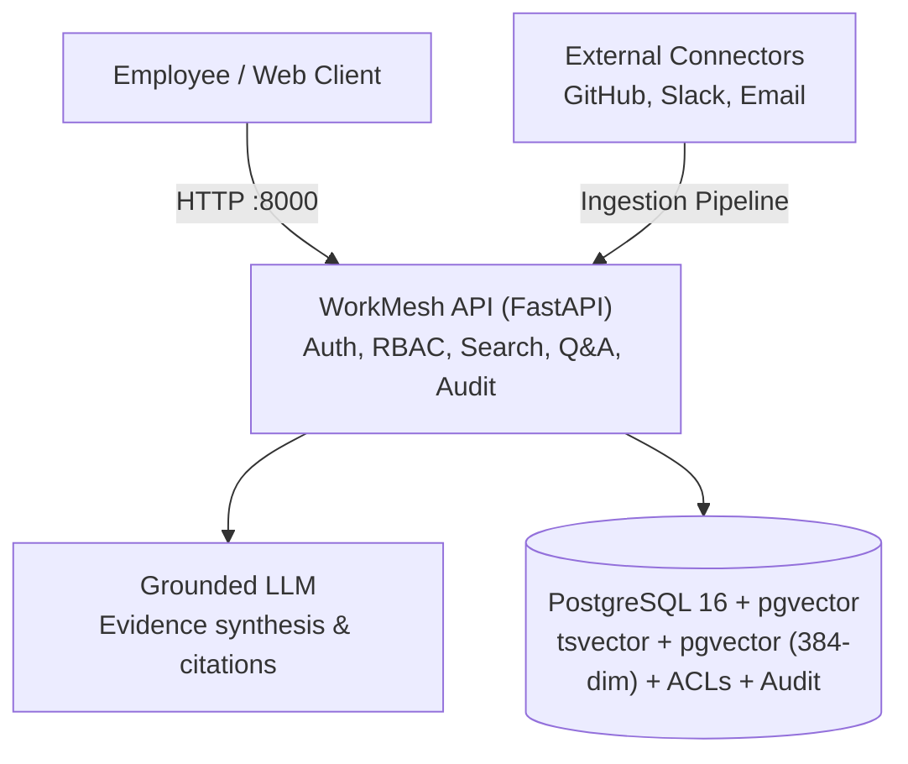

# System Design: WorkMesh

An enterprise knowledge search and question answering platform that traces engineering decisions across disparate tools with permission-aware citations.

## 1. Problem

An engineer or auditor asks:
> *"Why did we change the payment card validation flow last quarter, and who approved it?"*

The answer exists — but it is scattered across multiple systems:

| Where | What it holds |
|---|---|
| GitHub | the PR and the commit that changed the code |
| Slack | the thread where the team discussed it |
| Jira | the ticket that requested the change |
| Email | the architectural approval that unblocked it |

Traditionally a human opens each tool, searches manually, and mentally stitches the story together. That is slow and permission-blind.

WorkMesh builds a search engine over that scattered knowledge with two core guarantees:

1. **Permission-aware:** A document an employee cannot access never appears in search results and never reaches the LLM.
2. **Cited:** Every claim in an answer links back to the original source with verifiable citations `[1]`.

## 2. Scope

**In scope:**
- A consolidated knowledge corpus spanning GitHub, Slack, and Email
- Exact identifier search (ticket IDs, commit hashes) and semantic rationale search
- Pushdown ACL filtering evaluated inside SQL queries before evidence is built
- LLM-synthesized answers with verifiable source citations
- Connectors with sync status monitoring, lease management, and durable audit logs
- Empirical evaluation benchmarks measuring Recall@K, MRR, latency, and permission leakage

**Explicitly out of scope:**
- Autonomous agent actions or mutating external tools
- Multi-tenant billing or SaaS account management
- Cross-platform permission synchronization daemons

## 3. Architecture

WorkMesh operates as a single consolidated FastAPI application interfacing directly with PostgreSQL 16 + pgvector.



### Why a Single Consolidated Service

Initially planned as a split gateway and retrieval architecture, the system was unified into a single FastAPI service (see [`docs/decisions/ADR-0001-single-service-consolidation.md`](docs/decisions/ADR-0001-single-service-consolidation.md) and [`docs/decisions/ADR-0003-gateway-merge.md`](docs/decisions/ADR-0003-gateway-merge.md)):
1. **Zero RPC Overhead:** Unifying auth, orchestration, and retrieval in Python eliminates inter-service HTTP hops and serialization overhead.
2. **Atomic Data & ACL Management:** Pushdown permission enforcement executes inside PostgreSQL queries alongside hybrid ranking.
3. **Simplified Deployment:** A single container footprint simplifies operations, monitoring, and local development.

### Why PostgreSQL + pgvector

One datastore for everything: users, sources, documents, chunks, ACL references, sync state, audit logs, entity relationships, and 384-dimensional dense vectors (`all-MiniLM-L6-v2`).

Pushdown permission filtering (`EXISTS (SELECT 1 FROM acl_references ...)`) and vector similarity search both occur in the **same query** on the **same row**, preventing permission leaks.

- **pgvector** (`vector(384)`) performs cosine similarity search.
- **PostgreSQL full-text search** (`tsvector` + GIN) performs lexical and exact identifier search.
- **Reciprocal Rank Fusion (RRF, $k=60$)** merges candidate rankings mathematically.

## 4. Query Flow

The query execution path:

```text
1. Employee submits a query (UI / API client -> FastAPI)
2. FastAPI authenticates the identity (JWT in prod / headers in dev)
3. FastAPI resolves user ID and authorized group memberships
4. Query classifier determines category (exact / keyword / semantic / mixed)
5. Lexical search (tsvector) ──┐
                               ├─ both SQL queries push down ACL checks, then fuse via RRF
6. Vector search (pgvector)   ──┘
7. Entity relationship graph boosting (+0.0020 max boost)
8. Diversity discounting (1.0, 0.8, 0.6 per document)
9. Evidence set built strictly from authorized chunks
10. Grounded LLM synthesizes answer with bracketed citations [1]
11. Audit event recorded durably
12. Final answer and citations returned to client
```

### The Permission Invariant

> **The SQL query is the security boundary.**

The LLM never sees an unauthorized document — not even in a filtered-out form. Access control is enforced in SQL before the evidence set is built. Prompt instructions are a defense-in-depth measure against hallucination, not the access control mechanism.

**Stateless Token Claims Trade-off:** In `AUTH_MODE=prod`, identity (`sub`), role, and `groups` are extracted directly from the signed JWT (`HS256` / configured algorithm allowlist) and bounded by `JWT_MAX_TTL_SECONDS`. Group membership changes upstream take effect only after the active JWT expires.

## 5. Ingestion Pipeline

```text
1. Connector fetches changes since last cursor (GitHub / Slack / Email)
2. Raw record is normalized to CanonicalDocument
3. Document is segmented into CanonicalChunks
4. ACL references are extracted and attached to document and chunks
5. Chunks are embedded into 384-dimensional dense vectors
6. Chunks, vectors, and ACLs written transactionally to PostgreSQL
7. Relationships extracted (TICKET -> THREAD -> PR -> COMMIT -> EMPLOYEE)
8. Sync cursor updated in sync_state
```

## 6. Technology Choices

| Choice | Component | Reason |
|---|---|---|
| Python | 3.12+ | Native ecosystem for ML, embeddings, and FastAPI |
| FastAPI | Web Framework | High-performance async ASGI with OpenAPI schema generation |
| PostgreSQL | 16 | Full-text search (GIN), relational ACLs, and ACID transactions |
| pgvector | 0.8.x | Native in-database vector similarity search (`vector(384)`) |
| sentence-transformers | Embeddings | Local `all-MiniLM-L6-v2` dense vector embeddings (offline) |
| PyJWT | Authentication | Cryptographic JWT token verification in production mode |

## 7. Document Map

| Document | Description |
|---|---|
| [README.md](README.md) | Project overview, quick start, and benchmark results |
| **DESIGN.md** (this file) | System architecture and design invariants |
| [`docs/architecture/overview.md`](docs/architecture/overview.md) | Component architecture and data models |
| [`docs/performance.md`](docs/performance.md) | PostgreSQL `EXPLAIN (ANALYZE, BUFFERS)` query plans on 10k chunks |
| [`docs/api/api-contract.md`](docs/api/api-contract.md) | Public and internal API contract specification |
| [`docs/decisions/ADR-0001-single-service-consolidation.md`](docs/decisions/ADR-0001-single-service-consolidation.md) | Consolidated single-service FastAPI architecture |
| [`docs/decisions/ADR-0002-redis-deferral.md`](docs/decisions/ADR-0002-redis-deferral.md) | Datastore simplicity and Redis deferral rationale |
| [`docs/decisions/ADR-0003-gateway-merge.md`](docs/decisions/ADR-0003-gateway-merge.md) | Rationale for merging the API gateway into `rag-python` |
| [`docs/runbooks/operations-guide.md`](docs/runbooks/operations-guide.md) | Operations, deployment, and runbook procedures |
