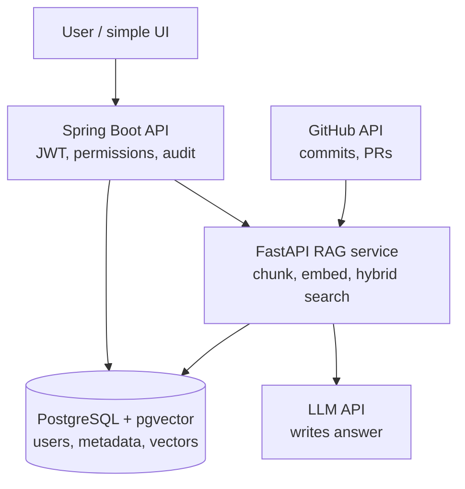

# Design Document — Employee Knowledge RAG

> **What this document is:** the single place that answers *"what are we building,
> why is it shaped this way, and what exists right now?"*
>
> **What it is not:** it is not a step-by-step tutorial. Business terms
> (ACL, chunking, hybrid retrieval, embedding) are defined in the journey
> package's `00_domain_glossary.md`, not repeated here.

**Project:** Employee Knowledge RAG — permission-aware enterprise knowledge
search.
**Current phase:** Phase 0 of 6 (foundations only).
**Last updated:** 2026-10-22

---

## 1. Problem

An engineer asks: *"why did we change the validation flow?"*

The answer exists — but it is scattered across four systems:

| Where | What it holds |
|---|---|
| GitHub | the PR and the commit that changed the code |
| Slack | the thread where the team argued about it |
| Jira | the ticket that asked for the change |
| Email | the approval that unblocked it |

Today a human has to open all four, read them, and mentally stitch the story
together. That is slow, and it is **permission-blind**: anyone can open a link
they should not see.

This project builds a search engine over that scattered knowledge, with two
non-negotiable properties:

1. **Permission-aware.** A document the employee cannot access must never
   appear in results, and must never reach the LLM.
2. **Cited.** Every claim in an answer links back to the original source, so a
   reviewer can verify it by opening the real PR, thread, or email.

## 2. Scope

**In scope**

- A single knowledge corpus spanning GitHub, Slack and Email
- Exact-match search (ticket IDs, commit hashes) and semantic search
  ("why did we change the validation flow?")
- Permission filtering applied *before* results are shown or sent to an LLM
- LLM-written answers with source links
- Sync status and audit trail
- A retrieval quality report

**Explicitly out of scope** (this is not a Glean / Copilot / Rovo rebuild)

- A general-purpose enterprise search over every company system
- Any autonomous agent that takes actions on the user's behalf
- Writing back to GitHub, Slack or Email
- Multi-tenant SaaS, billing, org administration
- Fine-grained document-level ACL inheritance across platforms

**Sharp use case instead:** trace one engineering decision — requirement →
discussion → PR → commit — with permission-aware citations.

## 3. Architecture



### Why two services

| Service | Language | Owns |
|---|---|---|
| `backend-java` | Java 21 / Spring Boot 3.5 | authentication, user context, permission decisions, REST APIs, orchestration, audit + admin endpoints |
| `rag-python` | Python 3.12+ / FastAPI | connectors, normalisation, chunking, embeddings, retrieval, reranking, relationships, LLM, evaluation |

Two reasons this split, and not one service or five:

1. **Permissions live in Java.** An enterprise reviewer asks *"who decided this
   employee could see this document?"* The answer is a Java class in a
   conventional Spring codebase — not a prompt string buried in Python.
2. **The AI side iterates fast.** Retrieval and prompting change weekly. The
   permission layer must not. Separating them means an AI change cannot
   accidentally weaken access control.

Full reasoning, alternatives considered, and consequences:
[`docs/decisions/ADR-0001-two-service-split.md`](docs/decisions/ADR-0001-two-service-split.md).

### Why PostgreSQL + pgvector

One datastore for everything: users, sources, documents, chunks, ACL
references, sync state, audit, relationships, **and** vectors.

The decisive reason is a join, not a feature list: permission filtering
(`chunk.acl_group_id IN (user's groups)`) and vector similarity search both
happen on the *same row* in the *same query*. Splitting search into a
separate engine would mean two systems that must agree on what the user may
see — a permission leak waiting to happen.

- **pgvector** stores embeddings and does similarity search.
- **PostgreSQL full-text search** does keyword/lexical search.
- Both run in parallel and their results are merged — that is the "hybrid" in
  hybrid retrieval.

Redis and a graph database are deliberately absent. See ADR-0001.

## 4. How a query flows

The single most important path in the system:

```text
1.  Employee submits a query (UI → Spring Boot)
2.  Spring Boot authenticates the employee        → who is asking
3.  Spring Boot resolves groups + ACL references   → what they may see
4.  Spring Boot calls rag-python with identity context
5.  rag-python classifies the query                → exact / keyword / semantic
6.  Lexical search (FTS)  ─┐
                           ├─ both filtered by ACL, then merged
7.  Vector search (pgvector) ┘
8.  Relationship enrichment                      → related PR/thread/ticket
9.  Merge + deduplicate
10. Rerank the surviving candidates
11. Build evidence set                           → ALREADY permission-filtered
12. LLM writes the answer from that evidence only
13. Answer + citations returned to Spring Boot
```

### The permission invariant

> **Step 11 is the security boundary, not step 12.**

The LLM never sees an unauthorized document — not even in a filtered-out form.
The prompt instruction "only use the provided evidence" is a *second* guard
against hallucination, **not** the thing preventing data leaks. Access control
is done in SQL, before the evidence set is built.

This is why ACL references are stored on every searchable unit **from Phase 1
onward**, even though permission enforcement arrives in Phase 4. Retrofitting
ACLs after real data is indexed means re-indexing everything.

## 5. How ingestion flows

```text
1.  Connector pulls changes since last cursor   (GitHub / Slack / Email)
2.  Raw item is normalized to a canonical document
3.  Document is split into source-aware chunks
4.  ACL metadata is extracted and attached to every chunk
5.  Each chunk is embedded into a vector
6.  Chunk + metadata + vector written to PostgreSQL
7.  Relationships extracted (TICKET → THREAD → PR → COMMIT → EMPLOYEE)
8.  Cursor advanced
```

Every connector implements the same interface, so a new source is a new class,
not a new pipeline:

```text
authenticate()          list_changes(cursor)     fetch_item(id)
normalize(item)         build_source_link(item)  extract_acl(item)
```

Each connector ships with **two** adapters: a real one (GitHub/Slack API) and a
**fixture** one (marked synthetic test data). This means OAuth setup or API
rate limits can never block the project, and evaluation runs deterministically.

## 6. Data model (planned — Phase 1)

| Table | Holds | Why it exists |
|---|---|---|
| `users` | employee identity | who asks a question |
| `groups` | team membership | permissions are granted to groups, not people |
| `user_group_membership` | user ↔ group | one employee can be in several teams |
| `source_records` | one row per source item (PR, thread, email) | the ACL unit and the citation target |
| `documents` | normalized content | canonical shape, independent of source |
| `chunks` | text + vector + ACL refs | the unit that is actually searched and filtered |
| `acl_references` | who may read a source item | kept separate so it can be joined without touching content |
| `sync_state` | per-source cursor | incremental sync without re-fetching everything |
| `audit_events` | who did what | the review trail |

Relationships are modelled as relational tables (`entities`, `relationships`),
**not** a graph database. AD-03: deterministic identifiers are enough to
demonstrate graph-style context at this scale.

## 7. Technology choices

| Choice | Version | Why this one |
|---|---|---|
| Java | 21 LTS | Records + sealed types make the DTO layer small and readable; LTS removes upgrade risk. *Deviation from the brief's Java 25 — see ADR-0001.* |
| Spring Boot | 3.5.x | Stable line; Actuator gives health/readiness for free |
| Python | 3.12+ | Required by modern FastAPI/pydantic |
| FastAPI | latest | Native OpenAPI + validation from type hints |
| PostgreSQL | 16 | Full-text search + transactions |
| pgvector | 0.8.x | Vector similarity inside the same database |
| Docker Compose | v2 | One command to run Postgres locally |

Deliberately **not** used: Kafka, Kubernetes, Neo4j, OpenSearch, Redis, event
bus, microservices. Each would add operational surface that a six-week project
does not need yet.

## 8. The Java ↔ Python contract

One narrow HTTP boundary, versioned under `/internal/v1/`.

```text
backend-java  ──POST /internal/v1/rag/health──▶  rag-python
```

- Java side: `RagServiceClient` interface → `RestClientRagServiceClient`
- Python side: `app/contracts/rag_health.py` (source of truth) + `app/api/internal_rag.py`
- Wire format is **camelCase** on both sides (Java's default; Python needs
  explicit aliases to match).
- **Both sides carry a contract test.** Renaming a field on one side fails a
  test on the other side, instead of failing at runtime.

This mechanism has already earned its keep: it caught a real camelCase /
snake_case mismatch, and a live test caught an HTTP/2-upgrade issue that
silently destroyed the POST body.

Full specification: [`docs/api/java-python-contract.md`](docs/api/java-python-contract.md).

## 9. Security posture

| Control | State |
|---|---|
| Secrets in env vars / secret manager | in place (`.env` git-ignored, `.env.example` committed) |
| Service-to-service authentication | **NOT built** — see below |
| Employee authentication | **NOT built** (Phase 1 stub only) |
| Permission enforcement | **NOT built** (Phase 4) |
| LLM sees only filtered evidence | by design (Phase 4); the LLM itself is Phase 4 |
| No autonomous agent actions | by design, and permanent |

**Service-to-service authentication is a hard prerequisite before any real
data flows.** The internal contract is currently unauthenticated, which is
acceptable only because the sole payload is a static health string. A shared
token or mTLS must exist before Phase 2 ingests anything real.

## 10. Current state vs target

**Exists today (Phase 0, verified):**

- `backend-java` skeleton — health/readiness/liveness, `RagServiceClient`
  boundary, `ApiError` error shape
- `rag-python` skeleton — `/health`, `/ready`, contract stub, structured JSON logs
- PostgreSQL + pgvector running locally (`vector 0.8.7`)
- Java ↔ Python contract, documented and tested on both sides
- 10 automated tests (5 JUnit, 5 pytest), all passing

**Does not exist yet:** every box in the diagram except the two services and the
database. No connectors, no retrieval, no LLM, no auth, no permissions.

The diagram at the top of this document shows the **target**, not the present.
The present state is tracked in [`docs/architecture/overview.md`](docs/architecture/overview.md),
which marks every component `[x]` exists / `[ ]` planned.

## 11. Phase roadmap

| Phase | Adds | Why here |
|---|---|---|
| 1 | canonical schema, user context, REST base, search/ask stubs | nothing can be stored or queried before this |
| 2 | canonical ingestion + GitHub | one source end-to-end proves the pipeline |
| 3 | hybrid retrieval + Slack | proves hybrid beats keyword-only |
| 4 | permissions + relationships + LLM + citations | the point of the whole project |
| 5 | email adapter + incremental sync + admin/audit | operational maturity |
| 6 | evaluation + observability + demo | prove it works, then show it |

## 12. Open questions

Carried into later phases; none block Phase 1.

1. **Which embedding model?** Affects vector column dimension and cost.
   Needs a provider-agnostic adapter — the model must not leak into callers.
2. **How are ACLs derived per source?** GitHub repo access, Slack channel
   membership, email folder — three different models. Phase 4.
3. **Which LLM provider?** Must be behind an adapter; the answer format and
   citation rules stay provider-independent.
4. **Is `traceId` worth adding now?** The error shape has the field but it is
   always `null`. Phase 1 decision.
5. **Java error mapping:** every RAG failure currently maps to `503`, but a
   malformed request from Java is a Java bug and should be `500`. Phase 1.

## 13. Document map

| Document | Read it for |
|---|---|
| [README.md](README.md) | what it is, how to run it, status |
| **DESIGN.md** (this file) | why it is shaped this way |
| [`docs/architecture/overview.md`](docs/architecture/overview.md) | both system flows, marked current vs planned |
| [`docs/api/java-python-contract.md`](docs/api/java-python-contract.md) | the wire contract between services |
| [`docs/decisions/ADR-0001-two-service-split.md`](docs/decisions/ADR-0001-two-service-split.md) | why two services, why Postgres |
| [`docs/runbooks/phase-0-local-run.md`](docs/runbooks/phase-0-local-run.md) | running it locally, troubleshooting |
