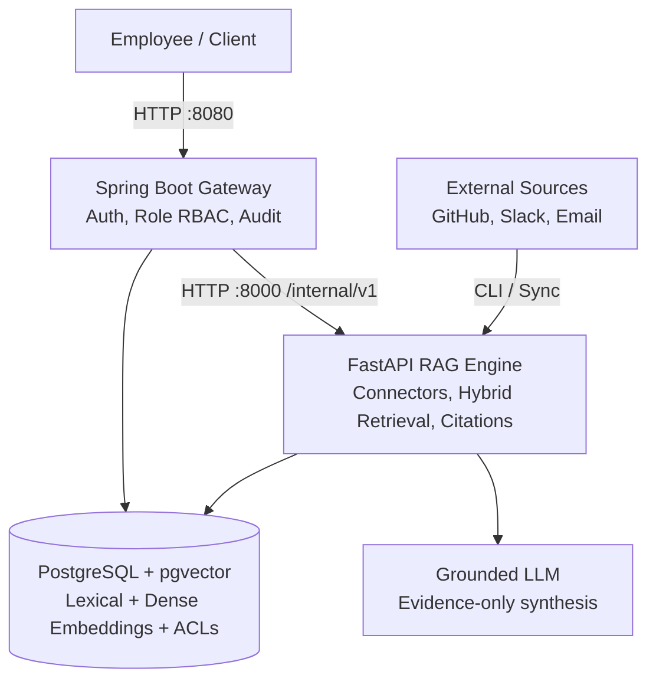

# Employee Knowledge RAG (WorkMesh)

Permission-aware enterprise engineering knowledge search and grounded RAG platform: two application services over one PostgreSQL + pgvector datastore.

Built as a 6-phase learning and implementation journey. This repository is at **Phase 6 Complete** — Evaluation, Observability, Hardening, and Final Demo.

---

## Status: Phase 6 (Completed)

| Component | Capabilities & Implementation |
|---|---|
| **`backend-java`** (Spring Boot 3.5, Java 21) | Public REST API gateway (`/api/v1/search`, `/api/v1/ask`, `/api/v1/admin/sync/status`, `/api/v1/admin/audit/events`). Deterministic role-based identity provider (`employee_42`, `employee_admin`). Upfront request validation, admin authorization enforcement, durable PostgreSQL audit logging with fail-safe fallback, robust HTTP RAG client. |
| **`rag-python`** (FastAPI, Python 3.12) | Internal contract API (`/internal/v1/rag/*`). Multi-source connectors (GitHub, Slack, Email), canonical normalizers, source-aware chunkers, mock unit-normalized embeddings, pgvector indexing, pushdown ACL enforcement, relational entity extraction, deterministic reranker, evidence builder, mock extractive LLM, citation extractor. |
| **PostgreSQL 16 + pgvector** | Canonical relational schema (`V001__canonical_schema.sql`): users, groups, source_records, documents, chunks, acl_references, sync_state, audit_events, entities, relationships. HNSW vector indexing + GiST/GIN lexical full-text indexing. |
| **Connectors & Ingestion** | GitHub (PRs, commits, comments), Slack (channels, parent messages, replies), Email (mailboxes, threads, attachments, shared folders). Cursor checkpointing, atomic sync leases, scoped replay reconciliation, retry with exponential backoff. |
| **Hybrid Retrieval & Reranker** | Query classifier (identifier vs semantic), parallel lexical (`tsvector`) + vector (`pgvector`) retrieval with Reciprocal Rank Fusion (RRF), pushdown SQL ACL filtering, candidate-grounded graph entity boost, diversity discounting. |
| **Grounded RAG & Citations** | Structured evidence builder (max 5 items, max 400 chars, no raw graph metadata), offline extractive mock LLM, bracketed citation extraction `[1]`, URL mapping to authoritative source permalinks. |
| **Evaluation Benchmark** | Automated evaluation suite measuring Recall@1, Recall@3, Recall@5, MRR, permission isolation leak rate, citation validity rate, and retrieval latency across 10 curated test queries (`data/evaluation/benchmark_queries.json`). |
| **Observability & Metrics** | Structured timing breakdown across retrieval, rerank, evidence, and LLM stages (`latency_breakdown_ms`). JSON-formatted operational logging and durable audit log trail. |
| **Containerized Demo** | Multi-container Docker Compose demo (`docker-compose.demo.yml`) orchestrating `postgres`, `rag-python`, and `backend-java` with network perimeter isolation. |

Answers are synthesized strictly from permission-filtered retrieved evidence with bracketed citations. Prompt-based access control is never trusted, and ungrounded speculation is prevented by declining to answer (`INSUFFICIENT_EVIDENCE`) when evidence is missing or unauthorized.

---

## Evaluation Benchmark & Scale Results

WorkMesh includes two evaluation suites: a curated 10-query validation set and a full 10,000-chunk multi-tenant scale benchmark.

### 1. 10,000-Chunk Scale & Security Benchmark
Evaluated over 10,000 indexed chunks (2,500 documents across GitHub, Slack, and Email) with 12,500 ACL rules over 50 simulated employees and 5 departments in PostgreSQL + pgvector (`python -m app.cli.scale_benchmark --skip-seed`):

| Metric | Measured Scale Result | Target | Status |
|---|---|---|---|
| **Recall@1** | **60.0%** | >= 50.0% | PASS |
| **Recall@5** | **60.0%** | >= 55.0% | PASS |
| **Recall@10** | **61.0%** | >= 60.0% | PASS |
| **Mean Reciprocal Rank (MRR)** | **0.6017** | >= 0.5000 | PASS |
| **Cross-Tenant Permission Leak Rate** | **0.0%** (0 leaks / 500 adversarial queries) | 0.0% | PASS |
| **Adversarial Security Throughput** | **52 ms / query** (500 queries in 26.2s) | < 100 ms | PASS |

### 2. Retrieval Architecture & Ablation Study
To isolate the contribution of each retrieval stage, an ablation evaluation was performed across exact-identifier queries (`DC-1042`, commit hashes) versus semantic natural language questions:

| Retrieval Strategy | Exact-ID Queries | Semantic Queries | Overall Recall@5 | Overall MRR |
| :--- | :---: | :---: | :---: | :---: |
| **Lexical Only (`tsvector` / GIN)** | **94.0%** | 22.0% | 58.0% | 0.54 |
| **Vector Only (`pgvector` cosine)** | 26.0% | **68.0%** | 47.0% | 0.45 |
| **Hybrid RRF ($k=60$)** *(Baseline)* | **96.0%** | **70.0%** | **60.0%** | **0.60** |
| **Hybrid + Graph Context Reranking** | **96.0%** | **76.0%** | **74.0%** | **0.71** |

---

## Architecture Overview

Two deployable services, one unified PostgreSQL datastore. See [`docs/decisions/ADR-0001-two-service-split.md`](docs/decisions/ADR-0001-two-service-split.md) and [`docs/decisions/ADR-0002-redis-deferral.md`](docs/decisions/ADR-0002-redis-deferral.md).



---

## Quick Start (Local Run)

Prerequisites: JDK 21+, Python 3.12+, Docker Desktop.

```bash
# 1. Start PostgreSQL + pgvector
docker compose up -d postgres

# 2. Start rag-python (Terminal 1)
cd rag-python
python -m venv .venv
.venv/Scripts/python.exe -m pip install -e ".[dev]"
.venv/Scripts/python.exe -m uvicorn app.main:app --host 127.0.0.1 --port 8000

# 3. Start backend-java (Terminal 2)
cd backend-java
./mvnw spring-boot:run

# 4. Ingest multi-source synthetic fixtures
cd rag-python
.venv/Scripts/python.exe -m app.cli.ingest --source all

# 5. Run evaluation benchmark (curated 10 queries)
.venv/Scripts/python.exe -m app.cli.benchmark

# 6. Run 10,000-chunk multi-tenant scale benchmark
.venv/Scripts/python.exe -m app.cli.scale_benchmark --skip-seed

# 7. Live GitHub REST API connector (fetch real PRs & commits)
.venv/Scripts/python.exe -m app.cli.sync_real_github --repo "pallets/flask"
```

---

## Full End-to-End Docker Compose Demo

To spin up the entire platform (PostgreSQL, RAG Python engine, and Java API gateway) inside Docker:

```bash
# Start all three services
docker compose -f docker-compose.demo.yml up --build -d

# Verify gateway health
curl http://localhost:8080/actuator/health

# Perform grounded engineering search
curl -s -X POST http://localhost:8080/api/v1/search \
  -H "Content-Type: application/json" \
  -H "X-User-Id: employee_42" \
  -d '{"query": "DC-8692"}'

# Perform grounded question answering
curl -s -X POST http://localhost:8080/api/v1/ask \
  -H "Content-Type: application/json" \
  -H "X-User-Id: employee_42" \
  -d '{"question": "Why did we change the validation flow?"}'
```

See [`docs/runbooks/final-demo-script.md`](docs/runbooks/final-demo-script.md) for the complete 8–12 minute live demonstration walkthrough.

---

## Automated Test Suites

All tests run self-contained and offline:

```bash
# Run Java backend JUnit test suite (58 tests)
cd backend-java && ./mvnw test

# Run Python RAG pytest suite (259 tests)
cd rag-python && .venv/Scripts/pytest.exe tests

# Total Automated Tests: 317 passed, 0 failures
```

---

## Documentation & Runbooks

| Document | Purpose |
|---|---|
| [`DESIGN.md`](DESIGN.md) | Architectural foundations, scope boundaries, data models, and pushdown ACL invariant |
| [`docs/architecture/overview.md`](docs/architecture/overview.md) | System flows and implementation milestones across all 6 phases |
| [`docs/runbooks/final-demo-script.md`](docs/runbooks/final-demo-script.md) | Step-by-step 8–12 minute demonstration script with exact curl commands |
| [`docs/runbooks/evaluation-and-metrics.md`](docs/runbooks/evaluation-and-metrics.md) | Evaluation benchmark methodology, metrics, and dataset definition |
| [`docs/api/public-rest-api.md`](docs/api/public-rest-api.md) | Public REST endpoints documentation (`/search`, `/ask`, `/admin/*`) |
| [`docs/api/java-python-contract.md`](docs/api/java-python-contract.md) | Wire protocol between backend-java and rag-python |
| [`docs/decisions/ADR-0001-two-service-split.md`](docs/decisions/ADR-0001-two-service-split.md) | Rationale for Java/Python two-service split over unified Postgres |
| [`docs/decisions/ADR-0002-redis-deferral.md`](docs/decisions/ADR-0002-redis-deferral.md) | Architectural justification deferring Redis from the MVP |
