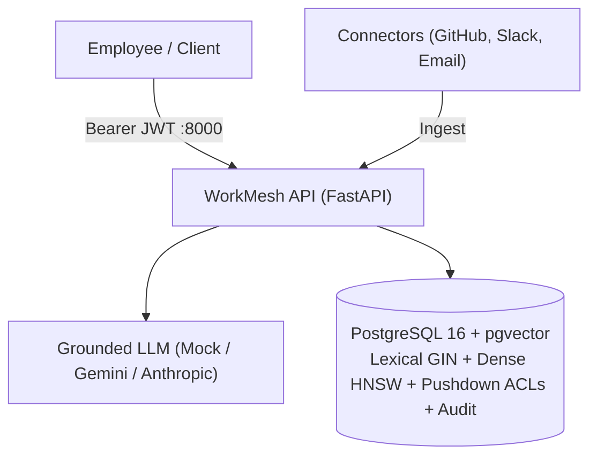

# WorkMesh

[](https://github.com/shivam22-source/WorkMesh/actions/workflows/ci.yml)

Permission-aware enterprise search and question answering with grounded citations. Built on FastAPI and PostgreSQL 16 with pgvector, WorkMesh combines GIN-indexed lexical full-text search with local CPU embeddings (`all-MiniLM-L6-v2`) via query-routed Reciprocal Rank Fusion ($k=60$). Document security is enforced directly inside database queries via SQL semi-joins before ranking or LIMIT boundaries are evaluated, guaranteeing zero permission leaks across multi-tenant teams.

---

## Headline Empirical Results

*All figures are empirically measured against PostgreSQL 16 + pgvector over 10,000 multi-tenant synthetic chunks (2,500 documents across GitHub, Slack, and Email) with 12,500 ACL rules across 50 simulated users and 5 departments:*

| Evaluation Dimension | Headline Result | Metric Details & Confidence Intervals | Source File |
|---|:---:|---|---|
| **Headline Retrieval (Pooled 90 Queries)** | **76.1% R@5** | **52.5% R@1**, **76.1% R@5 [67.8%, 83.9%]**, **0.7800 MRR**, **0.7515 nDCG@10**, **p50/p95: 174.8 / 203.9 ms** | [`pooled_90_results.json`](data/evaluation/results/pooled_90_results.json) |
| **Dev vs. Held-Out Generalization** | **80.0% R@5** | Dev (60): **74.2% R@5 [62.5%, 84.2%]**; Held-Out (30 unseen): **80.0% R@5 [66.7%, 91.7%]**, **0.7933 nDCG@10** | [`ablation_v2_results.json`](data/evaluation/results/ablation_v2_results.json), [`heldout_v2_results.json`](data/evaluation/results/heldout_v2_results.json) |
| **Permission Leak Rate** | **0.0%** | **0 leaks / 500 adversarial scale queries**; **0 leaks / 12 denied-identity queries** | [`scale_benchmark_results.json`](data/evaluation/results/scale_benchmark_results.json), [`ablation_v2_results.json`](data/evaluation/results/ablation_v2_results.json) |
| **Concurrency & Throughput** | **38.4 req/s** | **38.37 req/s** at 15 users (p95: 640 ms); limiter sheds excess load via HTTP 503 backpressure | [`docs/LOAD_TEST.md`](docs/LOAD_TEST.md) |
| **Multi-Hop Citation Coverage** | **76.7%** | Single-shot `/ask` (**194.2 ms**) vs multi-step `/agent/ask` (**393.7 ms**); both achieve **76.67% gold coverage** | [`agent_eval_results.json`](data/evaluation/results/agent_eval_results.json) |

---

## Architecture



---

## Quick Start

```bash
# 1. Start PostgreSQL and WorkMesh API
docker compose -f docker-compose.demo.yml up --build -d

# 2. Query enterprise knowledge with Bearer token (or dev mode simulation header)
curl -s -X POST http://localhost:8000/api/v1/search \
  -H "Content-Type: application/json" -H "X-User-Id: employee_42" -d '{"query": "DC-8692"}'

# 3. Run the pooled 90-query retrieval benchmark
python -m app.cli.eval_v2 --queries ../data/evaluation/queries_pooled_90.jsonl
```

For production JWT authentication using `scripts/make_token.py` (Linux/macOS and Windows), see [`docs/SECURITY.md`](docs/SECURITY.md).

---

## Real vs. Mocked Components

| Component | Status | Details |
|---|---|---|
| **Embeddings & Vector Index** | **Real** | Local HuggingFace `sentence-transformers` (`all-MiniLM-L6-v2`, 384d) with `pgvector` HNSW index (`ef_search=200`). |
| **Lexical Search & Hybrid Fusion** | **Real** | PostgreSQL `tsvector` (GIN, AND semantics), fused with dense vectors via query-routed RRF ($k=60$). |
| **Graph Reranking** | **Experimental (`off` by default)** | Reduced exact-ID recall (dev R@5 73.3% to 68.3%, held-out 80.0% to 71.7%) without multi-source gain; stays off by default. |
| **Cross-Encoder Reranker** | **Optional (`off` by default)** | `cross-encoder/ms-marco-MiniLM-L-6-v2` over top-50 ACL candidates. Kept off due to 4.3x CPU latency increase (`203 -> 871 ms`). |
| **Pushdown Security & RBAC** | **Real** | SQL semi-join filtering inside PostgreSQL before LIMIT. Prod mode enforces signed JWTs (`sub`, `role`, `groups`). |
| **LLM Provider Layer** | **Pluggable (`mock`, `gemini`, `anthropic`)** | Deterministic mock default (`mock-grounded-v1`). Anthropic and Gemini providers implemented and test-mocked, not live-tested in evals. |
| **Corpus & Connectors** | **Synthetic / Fixtures** | 10k chunks across 2.5k docs and 12.5k ACL rules. GitHub, Slack, and Email ingest from local JSON fixtures. |

---

## Limitations

1. **Synthetic Corpus**: Evaluated on 10,000 template-generated chunks across 2,500 documents and 12,500 ACL rules; not real company data.
2. **Gold Chunk Characteristics**: Benchmark gold chunks are primarily single-sentence, handwritten reference passages.
3. **Dev Split Parameter Tuning**: HNSW parameters (`ef_search=200`) and routing weights were tuned on the 60 dev queries; held-out 30-query split demonstrates consistent generalization (80.0% R@5, 0.7933 nDCG@10).
4. **Mock Default LLM**: Rule-grounded deterministic mock provider ensures reproducible, zero-cost tests without external network dependencies.
5. **Fixture Connectors**: GitHub, Slack, and Email connectors ingest from local JSON fixtures rather than live SaaS OAuth APIs.
6. **Token-Claim Staleness**: Group memberships in JWT claims remain stale until token expiration or refresh.
7. **Single-Node Architecture & CPU Embeddings**: Single-node PostgreSQL deployment; CPU neural embeddings are the primary throughput bottleneck under load.

---

## Detailed Documentation

- [`docs/EVALUATION.md`](docs/EVALUATION.md): Full pooled 90-query ablation, dev/held-out splits, latency regression analysis, and OR vs AND EXPLAIN deep-dive.
- [`docs/LOAD_TEST.md`](docs/LOAD_TEST.md): Concurrency limiter, 503 backpressure, Locust load test table, and multi-tenant ACL tier verification.
- [`docs/AGENT.md`](docs/AGENT.md): Multi-step agent architecture, security invariants, tool catalog, and multi-hop benchmark.
- [`docs/SECURITY.md`](docs/SECURITY.md): Pushdown SQL ACL design, production JWT auth, token generator, and zero-leak proofs.
- [`docs/performance.md`](docs/performance.md): PostgreSQL query execution plans, HNSW index usage, and EXPLAIN ANALYZE deep-dive.
- [`docs/experiments.md`](docs/experiments.md): Parameter sweeps, Cross-Encoder latency/recall trade-offs, and experimental graph boost findings.
