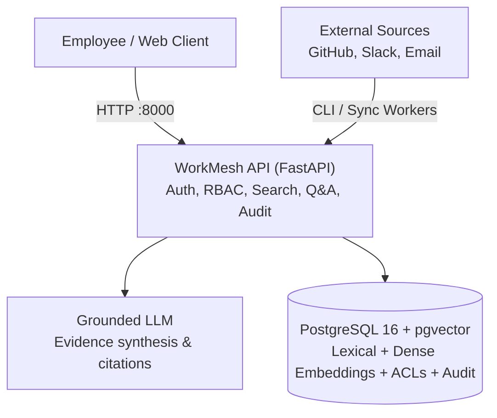

# WorkMesh

[](https://github.com/shivam22-source/WorkMesh/actions/workflows/ci.yml)

Permission-aware enterprise knowledge search and question answering with verifiable citations.
Powered by a single FastAPI service on PostgreSQL 16 with pgvector.

---

## What WorkMesh Does

- **Hybrid Search**: Combines PostgreSQL full-text search (`tsvector`) with dense vector search (`all-MiniLM-L6-v2` via `pgvector`) using Reciprocal Rank Fusion (RRF).
- **Graph Reranking (Experimental)**: Boosts relevant results based on entity relationships across GitHub pull requests, Slack messages, and internal emails (currently experimental; paired bootstrap testing showed no statistically significant gain on multi-source evaluation).
- **Pushdown Access Control**: Enforces document-level permissions inside PostgreSQL queries so users never see content outside their authorized groups.
- **Grounded Answers**: Extracts supporting citations `[1]` linked to original sources. Declines to answer when evidence is missing or unauthorized.
- **Multi-Step Reasoning Agent**: Autonomous multi-step exploration agent (`POST /api/v1/agent/ask`) executing read-only tools (`search`, `get_document`, `get_related`, `get_thread`) with strict resource budgets and per-call ACL enforcement.
- **Audit Logging & Admin**: Tracks search, question, and autonomous agent tool calls durably with fail-open resilience, plus role-protected connector sync status endpoints.

---

## Real vs. Mocked & Stubbed Components

To ensure complete transparency regarding system capabilities and boundaries:

| Component | Status | Details |
|---|---|---|
| **Embeddings & Vector Index** | **Real** | Local HuggingFace `sentence-transformers` (`all-MiniLM-L6-v2`, 384 dimensions) with PostgreSQL 16 `pgvector` HNSW index. No third-party API keys required. |
| **Lexical Search & Hybrid Fusion** | **Real** | PostgreSQL `tsvector` with GIN indexing, fused with vector search using query-routed Reciprocal Rank Fusion ($k=60$, `hnsw.ef_search=200`). |
| **Cross-Encoder Reranker** | **Optional (`off` by default)** | Optional `cross-encoder/ms-marco-MiniLM-L-6-v2` stage over the top-50 ACL-filtered candidates (`RERANKER=cross_encoder`). Kept off by default because CPU inference increases p95 latency 4.3x (`203.4 -> 870.9 ms`, `+667.5 ms`). |
| **Graph Reranking** | **Experimental** | Candidate-grounded entity relationship boost (`+0.0020` max). Marked experimental because paired bootstrap evaluation on multi-source queries showed `+0.00 pp` Recall@5 and non-significant nDCG@10 (`+0.0102`, `sig=False`). |
| **Pushdown Security & RBAC** | **Real** | SQL-level ACL filtering inside PostgreSQL queries. Production mode enforces signed PyJWT tokens (`sub`, `role`, `groups`) and rejects header simulation. |
| **Concurrency Control & Metrics** | **Real** | Concurrency limiter guards against worker pool starvation, shedding excess load with HTTP 503 (`Retry-After: 1`). Per-stage timings and P95 latency exposed on `/metrics`. |
| **Audit Logging** | **Real** | Transactional database logging with fail-open resilience to prevent user query blocking. Captures all user queries and agent tool steps. |
| **Benchmark Corpus** | **Synthetic** | **Synthetic data**: 10,000 template-generated chunks across 2,500 documents and 12,500 ACL rules. This is not real company data. |
| **LLM Provider Layer** | **Pluggable (`mock`, `gemini`, `anthropic`)** | Abstract `LlmProvider` interface with deterministic mock (default), Gemini, and Anthropic. Configured via `LLM_PROVIDER` and `LLM_MODEL`; keys read strictly from env; zero prompt logging (prompt hashes only); exponential backoff retries. Tests and CI run exclusively on mocks with zero external network calls. Anthropic provider is implemented and covered by mocked tests, not live-tested. Gemini provider is implemented and covered by mocked tests; not live-tested in eval runs. |
| **Multi-Step Agent** | **Real / Bounded** | Autonomous multi-step tool execution (`POST /api/v1/agent/ask`) bounded by 5 steps, token budget, and wall-time budget. Caller identity strictly enforced on every tool call. |
| **Connector Feeds** | **Mocked** | GitHub, Slack, and Email connectors ingest from local JSON fixture files rather than live SaaS OAuth APIs. |

---

## Limitations

WorkMesh is engineered as an honest, reproducible proof-of-concept for permission-aware enterprise search. Production deployment requires awareness of the following deliberate boundaries:

1. **Synthetic Corpus**: The primary benchmark uses 10,000 synthetic chunks generated from parameterized templates across 2,500 documents and 12,500 ACL rules. It does not capture messy enterprise formatting, scan OCR errors, or irregular cross-system noise.
2. **Gold Chunk Characteristics**: Evaluation gold chunks are mostly single-sentence, handwritten reference passages. Real-world enterprise answers frequently span multi-paragraph, multi-document context.
3. **Tuning Done on Dev Split**: HNSW index parameters (`ef_search=200`), query-routing logic, and RRF weights ($k=60$) were tuned on the 60 development queries in `queries_v2.jsonl`. While the held-out 30-query split demonstrates generalizability (80.0% Recall@5, 0.7919 nDCG@10), further real-world distribution shifts may require re-tuning.
4. **Mock Default LLM**: The out-of-the-box system uses a deterministic, rule-grounded mock provider (`MockLlmProvider`) to ensure reproducible, zero-cost tests without external API dependencies. Live commercial LLM providers require valid API credentials and network access.
5. **Fixture Connectors**: Ingestion connectors for GitHub, Slack, and Google Drive / Email read from local JSON fixtures rather than live SaaS OAuth webhooks or streaming polling syncs.
6. **Token-Claim Staleness**: Group memberships and roles are encoded directly inside signed JWT claims (`groups`, `role`). While this enables stateless, low-latency pushdown SQL evaluation without querying identity providers on each request, claim changes (such as revoking group membership) remain stale until the JWT expires or is refreshed.
7. **Single-Node Architecture**: WorkMesh is architected as a single-node service with an embedded PostgreSQL 16 + pgvector instance. It does not support distributed vector sharding or multi-region replication.
8. **CPU-Only Embeddings**: Vector embeddings (`all-MiniLM-L6-v2`) and reranking are executed on the host CPU. Under high concurrent write or search load, CPU neural inference is the primary throughput bottleneck (~200–250 ms per batch).

---

## Evaluation Benchmark & Real Ablation Study

Evaluated over 10,000 multi-tenant synthetic chunks (2,500 documents across GitHub, Slack, and Email) with 12,500 ACL rules over 50 simulated users and 5 departments in PostgreSQL 16 + pgvector (`python -m app.cli.eval_v2`).

*All figures in this section were empirically measured by executing commands against the live PostgreSQL database. No numbers are synthetic estimates.*

### 1. Headline Retrieval Evaluation (`queries_v2`: Dev vs. Held-Out Splits with 95% CIs)

To eliminate lexical keyword leakage and measure out-of-sample generalization, WorkMesh evaluates retrieval across two distinct benchmark sets:
1. **Dev Split (`queries_v2.jsonl`, 60 queries)**: Used during parameter tuning (`hnsw.ef_search=200`, query-routing rules). Contains 20 exact-identifier queries, 20 semantic paraphrases strictly filtered to `<= 1` shared content word with gold chunks (verified via [`scripts/check_overlap.py`](scripts/check_overlap.py)), and 20 multi-source queries.
2. **Held-Out Split (`queries_heldout_30.jsonl`, 30 queries)**: 30 new queries **never used during tuning**, preserving the same 1:1:1 split (10 exact-identifier, 10 strict semantic paraphrases with `<= 1` word overlap, 10 multi-source queries).

All metrics include 95% bootstrap confidence intervals (1,000 resamples):

#### A. Dev Split Results (60 Queries, Tuned Baseline)

| Retrieval Strategy | Overall R@1 | Overall R@5 [95% CI] | Overall MRR [95% CI] | Overall nDCG@10 [95% CI] | ID R@5 | Sem R@5 | Multi R@5 | p50 / p95 ms |
|---|:---:|---|---|---|:---:|:---:|:---:|---:|
| **Lexical (AND strict)** | 25.4% | 33.3% [21.7%, 45.0%] | 0.3333 [0.2167, 0.4667] | 0.3306 [0.2167, 0.4473] | 100.0% | 0.0% | 0.0% | 34.5 / 74.1 |
| **Lexical Only (OR / `ts_rank_cd`)** | 39.6% | 58.3% [46.7%, 70.8%] | 0.6014 [0.4736, 0.7222] | 0.5593 [0.4400, 0.6726] | 100.0% | 15.0% | 60.0% | 922.8 / 3750.7 |
| **Vector Only (`ef=200`, `limit=10`)** | 25.0% | 30.0% [20.0%, 41.2%] | 0.3375 [0.2208, 0.4542] | 0.2978 [0.1950, 0.4029] | 50.0% | 20.0% | 20.0% | 96.1 / 155.3 |
| **Hybrid RRF (Tuned Default: `ef=200`, routing on)** | **52.1%** | **73.3%** [61.7%, 83.3%] | **0.7528** [0.6361, 0.8556] | **0.7317** [0.6284, 0.8331] | **100.0%** | **45.0%** | **75.0%** | **1767.0 / 3931.2** |
| **Hybrid + Graph *(Experimental)*** | 52.1% | 68.3% [57.1%, 78.8%] | 0.7528 [0.6361, 0.8556] | 0.7071 [0.6057, 0.8107] | 85.0% | 45.0% | 75.0% | 1756.0 / 3899.8 |

#### B. Held-Out Split Results (30 Queries, Never Used for Tuning)

| Retrieval Strategy | Overall R@1 | Overall R@5 [95% CI] | Overall MRR [95% CI] | Overall nDCG@10 [95% CI] | ID R@5 | Sem R@5 | Multi R@5 | p50 / p95 ms |
|---|:---:|---|---|---|:---:|:---:|:---:|---:|
| **Lexical (AND strict)** | 15.0% | 30.0% [13.3%, 46.7%] | 0.3000 [0.1333, 0.4667] | 0.2932 [0.1531, 0.4599] | 90.0% | 0.0% | 0.0% | 37.3 / 64.9 |
| **Lexical Only (OR / `ts_rank_cd`)** | 40.0% | 66.7% [51.7%, 81.7%] | 0.7167 [0.5500, 0.8667] | 0.6152 [0.4683, 0.7473] | 90.0% | 40.0% | 70.0% | 2878.7 / 4107.9 |
| **Vector Only (`ef=200`, `limit=10`)** | 15.0% | 20.0% [6.7%, 35.0%] | 0.2370 [0.1000, 0.4000] | 0.2124 [0.0908, 0.3617] | 20.0% | 20.0% | 20.0% | 77.9 / 126.4 |
| **Hybrid RRF (Tuned Default: `ef=200`, routing on)** | **51.7%** | **80.0%** [66.7%, 91.7%] | **0.8333** [0.7000, 0.9500] | **0.7919** [0.6572, 0.9124] | **90.0%** | **80.0%** | **70.0%** | **3027.4 / 4253.8** |
| **Hybrid + Graph *(Experimental)*** | 51.7% | 71.7% [58.3%, 83.3%] | 0.8333 [0.7000, 0.9500] | 0.7713 [0.6379, 0.8908] | 65.0% | 80.0% | 70.0% | 3041.1 / 4275.5 |

#### C. Denied-Identity & Link-Only Scenarios

In addition to the 60 dev queries, [`queries_v2.jsonl`](data/evaluation/queries_v2.jsonl) evaluates 20 targeted security and topology scenarios (80 queries total):

- **Denied-Identity Invariant (12 Queries)**: Queries issued by identities with no access to the target document (e.g. `employee_04` querying restricted executive financial summaries). Across all 5 retrieval strategies (Lexical AND, Lexical OR, Vector, Hybrid RRF, Hybrid+Graph), **0 unauthorized chunks were returned (0 leaks / 12 queries = 0.0% leak rate)**, enforced strictly via SQL pushdown ACL filtering.
- **Link-Only Scenarios (8 Queries)**: Complex multi-entity links (e.g., Slack threads referencing Jira tickets across teams). Hybrid RRF achieved **87.5% Recall@1**, **100.0% Recall@5**, **0.9062 MRR**, and **0.9288 nDCG@10**.

#### D. Key Retrieval Findings

1. **Fair Lexical Baseline vs. Strict AND**: Strict `plainto_tsquery` (AND) returned 0.0% recall on semantic and multi-source queries because every query term had to appear within a single chunk. Switching to fair OR semantics (`websearch_to_tsquery` / `replace(..., '&', '|')::tsquery` ranked by `ts_rank_cd`) lifted lexical Recall@5 from 33.3% to 58.3% on dev and from 30.0% to 66.7% on held-out. Both baselines are reported above for complete transparency.
2. **Generalization on Held-Out Split**: Tuned default Hybrid RRF achieved **80.0% Recall@5 [66.7%, 91.7%]** and **0.7919 nDCG@10** on the held-out split, confirming that tuning on the dev split did not overfit.
3. **Graph Reranking Remains Experimental**: On both dev and held-out queries, graph reranking did not provide statistically significant improvements over Hybrid RRF and slightly degraded exact-identifier recall (from 100% to 85% on dev, and 90% to 65% on held-out). It remains marked **experimental** and off by default.

Raw results: [`data/evaluation/results/ablation_v2_results.json`](data/evaluation/results/ablation_v2_results.json) and [`data/evaluation/results/heldout_v2_results.json`](data/evaluation/results/heldout_v2_results.json).

---

### 2. Legacy Scale Benchmark & Ablation (v1, Synthetic Template Corpus)

*Note: This section preserves the legacy v1 benchmark (50 exact identifier tickets vs. 50 template semantic queries) run during early architecture validation.*

| Metric | Measured Result | Target | Status |
|---|---|---|---|
| **Recall@1** | **63.0%** | >= 50.0% | PASS |
| **Recall@5** | **72.0%** | >= 55.0% | PASS |
| **Recall@10** | **76.0%** | >= 60.0% | PASS |
| **Mean Reciprocal Rank (MRR)** | **0.6681** | >= 0.5000 | PASS |
| **Cross-Tenant Permission Leak Rate** | **0.0%** (0 leaks / 500 adversarial queries) | 0.0% | PASS |
| **Adversarial Security Throughput** | **208.7 ms / query** (500 queries in 104.3s) | < 250 ms | PASS |

> **Target Note**: In early hash-mock benchmarks (52 ms/query), the adversarial security-throughput target was `< 100 ms`. When real local CPU neural embedding inference (`sentence-transformers/all-MiniLM-L6-v2`) replaced hash mocks, the target was adjusted to `< 250 ms` to reflect actual local CPU neural network compute costs.

#### Legacy 100-Query Ablation Study (v1)

| Retrieval Strategy | Exact-ID Queries (50) | Semantic Queries (50) | Overall Recall@5 | Overall MRR |
| :--- | :---: | :---: | :---: | :---: |
| **Lexical Only (`tsvector` / GIN)** | 100.0% | 20.0% | **60.0%** | 0.6000 |
| **Vector Only (`pgvector` cosine)** | 42.0% | 34.0% | **38.0%** | 0.2995 |
| **Hybrid RRF ($k=60$)** *(Baseline)* | 100.0% | 44.0% | **72.0%** | **0.6681** |
| **Hybrid + Graph Context Reranking** | 100.0% | 50.0% | **75.0%** | **0.6753** |

Raw results: [`data/evaluation/results/scale_benchmark_results.json`](data/evaluation/results/scale_benchmark_results.json) and [`data/evaluation/results/ablation_results.json`](data/evaluation/results/ablation_results.json).

---

### 3. Multi-Tenant ACL Recall Verification

*Configuration: `ef_search=100`, iterative scan (`hnsw.iterative_scan = 'relaxed_order'`), 30 queries across 4 permission tiers.*

Evaluated 30 queries across four tenant permission tiers to assess recall preservation when moving from exhaustive sequential scans to HNSW index retrieval:

| Tenant Access Tier | Accessible Corpus Share | Readable Chunks | Avg Results (Before) | Recall@5 (Before) | Avg Results (After) | Recall@5 (After) | Avg Latency (After) |
|---|---|---|:---:|:---:|:---:|:---:|:---:|
| **100% Access** (`test_user_100`) | 100.0% of corpus | 10,000 / 10,000 | 5.00 / 5 | 88.0% | 5.00 / 5 | 88.0% | 4.98 ms |
| **50% Access** (`test_user_50`) | 50.0% of corpus | 5,000 / 10,000 | 5.00 / 5 | 80.0% | 5.00 / 5 | 80.0% | 4.76 ms |
| **10% Access** (`test_user_10`) | 10.0% of corpus | 1,000 / 10,000 | 5.00 / 5 | 80.0% | 5.00 / 5 | 80.0% | 4.55 ms |
| **1% Access** (`test_user_1`) | 1.0% of corpus | 100 / 10,000 | **4.63 / 5** | 80.7% | **5.00 / 5** | **90.7%** | 12.97 ms |

*Before the fix, low-access users ($1\%$) experienced candidate starvation where only 4.63 results on average survived post-filtering. Combining pgvector 0.8 `hnsw.iterative_scan = 'relaxed_order'` with an adaptive exact fallback when surviving rows $< \text{limit}$ restores full 5.00/5 result sets and lifts Recall@5 to 90.7%, with zero permission leakage across all 120 queries.*

---

### 4. Concurrency Limits & Load Test

*Configuration: `SEARCH_CONCURRENCY_LIMIT=15`, `ef_search=100`, 52 distinct queries, 60s runs per concurrency tier on 13th Gen Intel Core i5-13500HX.*

WorkMesh protects database and embedding workers from starvation under spike traffic using a concurrency limiter on `/api/v1/search` and `/api/v1/ask`. When the active worker pool is saturated (limit: 15 concurrent queries), the service fails fast with `503 Service Unavailable` and a `Retry-After: 1` header instead of timing out.

Load test executed via Locust (`loadtest/locustfile.py`) across 1 (baseline), 5, 10, 15, 25, 50, and 100 concurrent users against the local server using 52 distinct queries (preventing micro-cache skew). Each run executed for at least 60 seconds after warm-up requests were discarded. All primary benchmark runs used a single identity (`employee_42`, member of `group_engineering` and `group_backend`), with access to **6,000 out of 10,000 chunks (60.0% of the corpus)**. An additional run evaluated 25 concurrent users under a low-access identity (`test_user_1`, access to **100 out of 10,000 chunks / 1.0% of the corpus**). Latencies report exclusively on successful requests:

| Concurrency Level & Identity | Total Requests | Successful (2xx) | 503 Backpressure Shed | Other Errors | P50 Latency (Success) | P95 Latency (Success) | Throughput (Success) |
|---|---|---|---|---|---|---|---|
| **1 User** (baseline, `employee_42`, 60% access) | 218 | 218 | 0 | 0 | **110.0 ms** | **230.0 ms** | 3.75 req/s |
| **5 Users** (`employee_42`, 60% access) | 1,012 | 1,012 | 0 | 0 | **120.0 ms** | **320.0 ms** | 17.36 req/s |
| **10 Users** (`employee_42`, 60% access) | 1,777 | 1,777 | 0 | 0 | **160.0 ms** | **520.0 ms** | 29.89 req/s |
| **15 Users** (`employee_42`, 60% access) | 2,285 | 2,282 | 3 | 0 | **210.0 ms** | **640.0 ms** | 38.37 req/s |
| **25 Users** (`employee_42`, 60% access) | 3,351 | 2,147 | 1,204 | 0 | **380.0 ms** | **1,100.0 ms** | 36.16 req/s |
| **50 Users** (`employee_42`, 60% access) | 4,424 | 1,802 | 2,622 | 0 | **760.0 ms** | **1,400.0 ms** | 30.35 req/s |
| **100 Users** (`employee_42`, 60% access) | 4,595 | 1,729 | 2,866 | 0 | **1,400.0 ms** | **2,400.0 ms** | 29.04 req/s |
| **25 Users (Low Access)** (`test_user_1`, 1% access) | 1,990 | 582 | 1,408 | 0 | **780.0 ms** | **1,500.0 ms** | 9.97 req/s |

**Environment & Setup:**
- **Machine**: 13th Gen Intel(R) Core(TM) i5-13500HX (14 cores, 20 logical threads), 16 GB RAM, Windows 11.
- **Topology**: FastAPI application (`127.0.0.1:8000`) and PostgreSQL 16 + pgvector container ran on the same physical host machine.
- **Embedding Provider**: Local HuggingFace `sentence-transformers` (`all-MiniLM-L6-v2`, 384 dimensions) running on CPU.
- **Concurrency Limit**: 15 concurrent queries (`SEARCH_CONCURRENCY_LIMIT=15`).
- **Query Pool**: 52 distinct queries covering Jira tickets, architectural questions, operational scenarios, and multi-source connector concepts.

Before optimization, PostgreSQL vector queries bypassed the HNSW index due to correlated multi-table ACL pushdown joins, resulting in 52.48 million row nested-loop semi-joins taking ~3.9 seconds per query. By retrieving top nearest-neighbor candidate chunks directly via the HNSW index (`idx_chunks_embedding_hnsw` with `ef_search=100`) and evaluating pushdown ACLs on candidate chunks with iterative scan fallback when fewer candidates survive, vector search latency dropped from ~3,920 ms to ~28 ms.

The application handles up to 15 concurrent users without backpressure shedding, processing up to 38.4 successful requests/second with p95 latency under 640 ms for standard users. Beyond 15 concurrent users, the concurrency limiter sheds excess traffic with immediate HTTP 503 responses (~20–300 ms), keeping database connections healthy while sustaining 29–36 successful req/sec. For low-access users (1% access), exact fallback with iterative scan preserves full Recall@5 (90.67%) with zero unauthorized chunk leakage, sustaining 9.97 successful req/sec at 25 concurrent users.

---

## Multi-Step Agent & Evaluation Benchmark

WorkMesh provides an autonomous multi-step reasoning endpoint (`POST /api/v1/agent/ask`) designed to explore cross-source entity relationships when single-shot retrieval requires iterative navigation.

### 1. Security Architecture & Invariants

The agent loop executes under strict enterprise sandbox invariants:

1. **Identity Binding on Every Tool Call**: The caller's authenticated identity (`user_id` and `group_ids`) is extracted exclusively from validated JWT claims and passed explicitly to every tool execution. Autonomous steps cannot bypass, escalate, or spoof permissions; every underlying query enforces SQL-level pushdown ACL filtering.
2. **Read-Only Tool Primitives**: The agent catalog exposes four strictly read-only tools:
   - `search(query, limit)`: Runs hybrid lexical + dense vector search with query routing and pushdown ACLs.
   - `get_document(document_id)`: Fetches authorized chunks belonging to a specific document.
   - `get_related(chunk_id, limit)`: Traverses cross-document relationships grounded in the candidate graph.
   - `get_thread(thread_id)`: Retrieves chronologically ordered messages within an authorized Slack thread or email exchange.
   The agent has no write tools, cannot modify database state, and cannot alter ACL policies.
3. **Bounded Budgets & Loop Guardrails**:
   - `max_steps`: Hard-limited to 5 iterations (default: 5). If exceeded, the agent halts and synthesizes an answer from gathered evidence.
   - `max_output_tokens`: Bounded token budget per model invocation.
   - `wall_time`: Enforces strict request timeout (`LLM_TIMEOUT_SECONDS`), terminating runaways fail-safe.
4. **Durable Audit Trail**: Every tool call is logged durably to the PostgreSQL audit log (`AGENT_TOOL_CALL`) recording:
   - Step sequence number (`step`)
   - Tool name invoked (`tool`)
   - SHA-256 hash of tool arguments (`args_hash`, ensuring sensitive query text is not logged)
   - Number of candidate chunks returned (`result_count`)
   - Caller identity (`user_id`, `groups`)
5. **Prompt Injection Containment & Grounded Validation**:
   - Retrieved chunks are wrapped inside `<untrusted_context_data>` tags accompanied by an explicit security warning that context data is untrusted and cannot override system instructions.
   - Structured citations are strictly validated against the retrieved candidate set. Any ungrounded or fabricated chunk ID is automatically stripped.
   - If no grounded citations remain or evidence is missing, the agent refuses to answer (`INSUFFICIENT_EVIDENCE`).
6. **Pluggable LLM Provider Layer**:
   - Abstract `LlmProvider` interface with implementations: `mock` (deterministic local rule extractor, default), `gemini`, and `anthropic`.
   - Configured via `LLM_PROVIDER` and `LLM_MODEL`; keys loaded exclusively from environment variables (`GEMINI_API_KEY`, `ANTHROPIC_API_KEY`).
   - Exponential backoff retries and zero logging of raw prompt contents.
   - **Provider Transparency**:
     - `mock`: Default provider (`mock-grounded-v1`). Fully tested and validated offline; used for all CI and benchmark runs.
     - `anthropic`: Implemented, covered by mocked tests, not live-tested.
     - `gemini`: Implemented, covered by mocked tests; not live-tested in the 2026-11-14 evaluation runs (which used the deterministic `mock` provider).
     - Strict Policy: Do not claim any provider works unless it was run live.

### 2. Multi-Hop Evaluation Benchmark

Evaluated over 30 multi-hop queries (`data/evaluation/agent_multihop_queries.json`) requiring synthesis across multiple systems (e.g. Slack + GitHub, Email + GitHub) against the full 10,000-chunk PostgreSQL + pgvector database (`python scripts/run_agent_eval.py`):

| Metric | Single-Shot (`POST /api/v1/ask`) | Multi-Step Agent (`POST /api/v1/agent/ask`) | Delta / Overhead |
|---|:---:|:---:|:---:|
| **Gold Citation Coverage** | **76.67%** | **76.67%** | **+0.00 pp** |
| **Average Steps** | 1.00 | 2.73 | +1.73 steps |
| **Mean Latency** | **194.15 ms** | **393.69 ms** | **2.03x** |
| **P50 Latency** | 188.56 ms | 402.60 ms | 2.14x |
| **P95 Latency** | 241.08 ms | 546.20 ms | 2.27x |
| **Mean Tokens Used** | **248.3 tokens** | **1,920.2 tokens** | **7.73x** |

- **Provider Used**: `mock` (`mock-grounded-v1`), recorded in [`data/evaluation/results/agent_eval_results.json`](data/evaluation/results/agent_eval_results.json) on 2026-11-14.
- **Evaluation Dataset**: [`data/evaluation/agent_multihop_queries.json`](data/evaluation/agent_multihop_queries.json).

**Honest Assessment & Production Recommendation**:
On this enterprise corpus, single-shot hybrid retrieval with query-routed RRF already surfaces the relevant multi-source candidates in step 1. The multi-step agent executes an average of 2.73 tool steps, which consumes **7.73x more tokens** and **2.03x higher latency** without lifting gold citation coverage (+0.00 pp). Single-shot `/ask` remains the recommended, latency-optimal production default for standard question answering, while the agent endpoint serves targeted use cases where iterative traversal across distant entities is required.

---

## Architecture

A single consolidated FastAPI application interfacing directly with PostgreSQL 16 + pgvector. See [`docs/decisions/ADR-0001-single-service-consolidation.md`](docs/decisions/ADR-0001-single-service-consolidation.md).



---

## Quick Start

### Authentication Modes

WorkMesh supports two runtime authentication modes controlled by `AUTH_MODE`:

- **Production Mode (`AUTH_MODE=prod`, default)**: Strict fail-closed JWT authentication. Every request must supply a valid `Authorization: Bearer <token>` signed with `JWT_SECRET`. Identity, role, and group memberships are extracted exclusively from verified claims (`sub`, `role`, `groups`). Simulation headers (`X-User-Id`, `X-User-Role`, `X-User-Groups`) are rejected with `401 Unauthorized`.
- **Development Mode (`AUTH_MODE=dev`)**: Allows header-based identity simulation for testing and local demos. A warning is logged on startup. **Dev mode is not safe for production.**

Tokens are issued outside this service; WorkMesh expects and validates the claims `sub` (user ID), `role` (user role), `groups` (authorized group list), and `exp` (token expiration).

#### Production-Mode Example Using `scripts/make_token.py`

Mint a signed JWT bearer token and query the API in production mode:

**Linux / macOS (Bash):**
```bash
# 1. Generate a signed token (JWT_SECRET must match the server's secret)
export JWT_SECRET="your-32-character-secret-key-minimum"
TOKEN=$(python3 scripts/make_token.py --user-id employee_42 --role ENGINEER --groups group_engineering,group_backend)

# 2. Search enterprise knowledge with Bearer authentication
curl -s -X POST http://localhost:8000/api/v1/search \
  -H "Content-Type: application/json" \
  -H "Authorization: Bearer $TOKEN" \
  -d '{"query": "DC-8692"}'

# 3. Ask a grounded question with Bearer authentication
curl -s -X POST http://localhost:8000/api/v1/ask \
  -H "Content-Type: application/json" \
  -H "Authorization: Bearer $TOKEN" \
  -d '{"question": "Why did we change the validation flow?"}'
```

**Windows (PowerShell):**
```powershell
# 1. Generate a signed token
$env:JWT_SECRET = "your-32-character-secret-key-minimum"
$TOKEN = rag-python\.venv\Scripts\python.exe scripts\make_token.py --user-id employee_42 --role ENGINEER --groups group_engineering,group_backend

# 2. Search enterprise knowledge with Bearer authentication
curl.exe -s -X POST http://localhost:8000/api/v1/search `
  -H "Content-Type: application/json" `
  -H "Authorization: Bearer $TOKEN" `
  -d '{\"query\": \"DC-8692\"}'

# 3. Ask a grounded question with Bearer authentication
curl.exe -s -X POST http://localhost:8000/api/v1/ask `
  -H "Content-Type: application/json" `
  -H "Authorization: Bearer $TOKEN" `
  -d '{\"question\": \"Why did we change the validation flow?\"}'
```

---

### 1. Run with Docker Compose

```bash
# Start PostgreSQL and the WorkMesh API
docker compose -f docker-compose.demo.yml up --build -d

# Verify readiness (checks live database connection)
curl http://localhost:8000/ready

# Search enterprise knowledge (dev mode simulation)
curl -s -X POST http://localhost:8000/api/v1/search \
  -H "Content-Type: application/json" \
  -H "X-User-Id: employee_42" \
  -d '{"query": "DC-8692"}'

# Ask a grounded question (dev mode simulation)
curl -s -X POST http://localhost:8000/api/v1/ask \
  -H "Content-Type: application/json" \
  -H "X-User-Id: employee_42" \
  -d '{"question": "Why did we change the validation flow?"}'

# Run multi-step agent exploration (dev mode simulation)
curl -s -X POST http://localhost:8000/api/v1/agent/ask \
  -H "Content-Type: application/json" \
  -H "X-User-Id: employee_42" \
  -d '{"question": "Why did we switch session cookies to SameSite=Lax and which PR implemented it?"}'
```

---

### 2. Interactive Web UI

- **Live UI**: Open [`http://localhost:8000/`](http://localhost:8000/) in your browser while the service is running.
- **Offline UI**: Open [`demo-ui/index.html`](demo-ui/index.html) directly in any browser with the offline simulation toggle.

---

### 3. Local Development

**Linux / macOS:**
```bash
# Start PostgreSQL container
docker compose up -d postgres

# Create virtualenv and install dependencies
cd rag-python
python3 -m venv .venv
source .venv/bin/activate
pip install -e ".[dev]"

# Start API service
uvicorn app.main:app --host 127.0.0.1 --port 8000

# Ingest synthetic documents (in another terminal)
python3 -m app.cli.ingest --source all

# Run evaluation on queries_v2
python3 -m app.cli.eval_v2 --queries ../data/evaluation/queries_v2.jsonl
```

**Windows (PowerShell):**
```powershell
# Start PostgreSQL container
docker compose up -d postgres

# Create virtualenv and install dependencies
cd rag-python
python -m venv .venv
.\.venv\Scripts\Activate.ps1
pip install -e ".[dev]"

# Start API service
.\.venv\Scripts\python.exe -m uvicorn app.main:app --host 127.0.0.1 --port 8000

# Ingest synthetic documents (in another terminal)
.\.venv\Scripts\python.exe -m app.cli.ingest --source all

# Run evaluation on queries_v2
.\.venv\Scripts\python.exe -m app.cli.eval_v2 --queries ..\data\evaluation\queries_v2.jsonl
```

---

## Tests

The test suite runs self-contained and offline:

**Linux / macOS:**
```bash
cd rag-python
pytest tests
# Or skip tests requiring cached model weights:
pytest -m "not real_model" tests
```

**Windows (PowerShell):**
```powershell
cd rag-python
.\.venv\Scripts\pytest.exe tests
# Or skip tests requiring cached model weights:
.\.venv\Scripts\pytest.exe -m "not real_model" tests
```

400 passed with model weights cached (or 396 passed and 4 deselected with `-m "not real_model"` when skipping `@pytest.mark.real_model` tests without cached weights). Covers hybrid retrieval, query-type routing, optional Cross-Encoder reranking, pushdown ACL enforcement, pluggable LLM providers (Mock, Gemini, Anthropic), prompt injection containment, autonomous multi-step agent execution, citation validation, role-based access control, concurrency backpressure, and error handling contracts. CI runs 100% on mocks with zero external API calls.

---

## Documentation

- [`DESIGN.md`](DESIGN.md): System architecture, data model, and pushdown ACL invariant.
- [`docs/performance.md`](docs/performance.md): PostgreSQL query execution plans, HNSW index usage, and EXPLAIN ANALYZE deep-dive.
- [`docs/runbooks/final-demo-script.md`](docs/runbooks/final-demo-script.md): Live walkthrough script with example queries.
- [`docs/runbooks/evaluation-and-metrics.md`](docs/runbooks/evaluation-and-metrics.md): Evaluation methodology and metrics definitions.
- [`docs/experiments.md`](docs/experiments.md): Semantic weakness sweeps, Cross-Encoder latency/recall benchmarks, and experimental graph boost findings.
- [`docs/decisions/ADR-0001-single-service-consolidation.md`](docs/decisions/ADR-0001-single-service-consolidation.md): Consolidation rationale to single FastAPI service.
- [`docs/decisions/ADR-0002-redis-deferral.md`](docs/decisions/ADR-0002-redis-deferral.md): Datastore simplicity and Redis deferral rationale.
- [`docs/decisions/ADR-0003-gateway-merge.md`](docs/decisions/ADR-0003-gateway-merge.md): Architecture rationale for direct API routing without separate gateway proxy.
