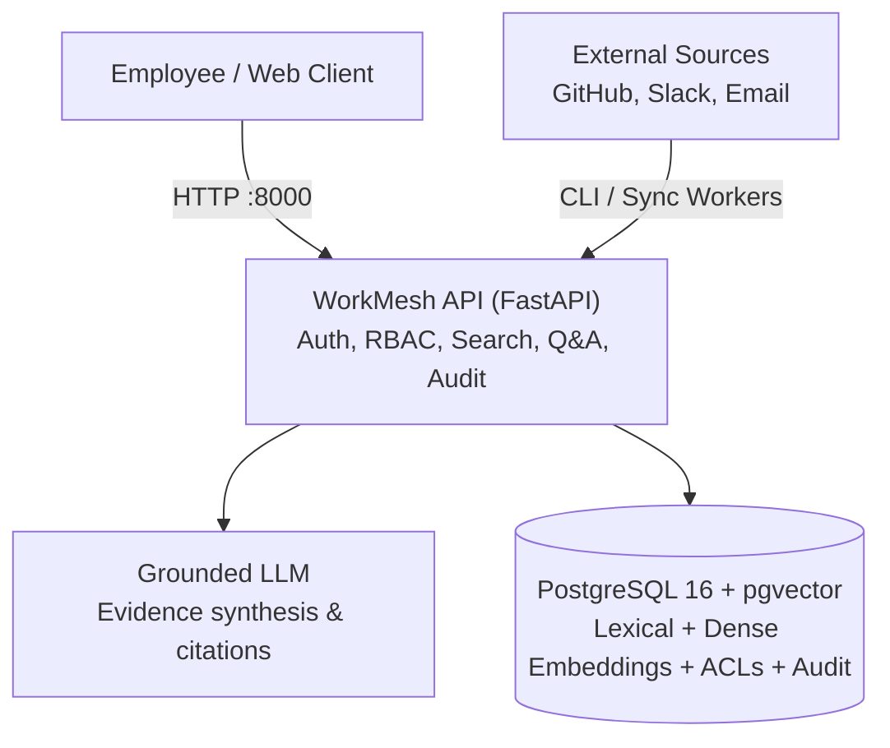

# WorkMesh

Permission-aware enterprise knowledge search and question answering with verifiable citations.
Powered by a single FastAPI service on PostgreSQL 16 with pgvector.

---

## What WorkMesh Does

- **Hybrid Search**: Combines PostgreSQL full-text search (`tsvector`) with dense vector search (`all-MiniLM-L6-v2` via `pgvector`) using Reciprocal Rank Fusion (RRF).
- **Graph Reranking**: Boosts relevant results based on entity relationships across GitHub pull requests, Slack messages, and internal emails.
- **Pushdown Access Control**: Enforces document-level permissions inside PostgreSQL queries so users never see content outside their authorized groups.
- **Grounded Answers**: Extracts supporting citations `[1]` linked to original sources. Declines to answer when evidence is missing or unauthorized.
- **Audit Logging & Admin**: Tracks search and question queries durably with fail-open resilience, plus role-protected connector sync status endpoints.

---

## Real vs. Mocked & Stubbed Components

To ensure complete transparency regarding system capabilities and boundaries:

| Component | Status | Details |
|---|---|---|
| **Embeddings & Vector Index** | **Real** | Local HuggingFace `sentence-transformers` (`all-MiniLM-L6-v2`, 384 dimensions) with PostgreSQL 16 `pgvector` HNSW index. No third-party API keys required. |
| **Lexical Search & Hybrid Fusion** | **Real** | PostgreSQL `tsvector` with GIN indexing, fused with vector search using Reciprocal Rank Fusion ($k=60$) and graph relationship boosts. |
| **Pushdown Security & RBAC** | **Real** | SQL-level ACL filtering inside PostgreSQL queries. Production mode enforces signed PyJWT tokens (`sub`, `role`, `groups`) and rejects header simulation. |
| **Concurrency Control & Metrics** | **Real** | Concurrency limiter guards against worker pool starvation, shedding excess load with HTTP 503 (`Retry-After: 1`). Per-stage timings and P95 latency exposed on `/metrics`. |
| **Audit Logging** | **Real** | Transactional database logging with fail-open resilience to prevent user query blocking. |
| **Benchmark Corpus** | **Synthetic** | **Synthetic data**: 10,000 template-generated chunks across 2,500 documents and 12,500 ACL rules. This is not real company data. |
| **LLM Answer Synthesis** | **Stubbed** | Deterministic rule-grounded passage extractor (`MockLLMProvider`). Extracts direct evidence and formats citations without calling a commercial LLM API (such as OpenAI or Anthropic). |
| **Connector Feeds** | **Mocked** | GitHub, Slack, and Email connectors ingest from local JSON fixture files rather than live SaaS OAuth APIs. |

---

## Evaluation Benchmark & Real Ablation Study

Evaluated over 10,000 multi-tenant synthetic chunks (2,500 documents across GitHub, Slack, and Email) with 12,500 ACL rules over 50 simulated users and 5 departments in PostgreSQL + pgvector (`python -m app.cli.scale_benchmark --skip-seed --ablation`).

*The retrieval benchmark and ablation numbers were re-run after the HNSW vector search change.*

### 1. Scale & Security Benchmark

| Metric | Measured Result | Target | Status |
|---|---|---|---|
| **Recall@1** | **64.0%** | >= 50.0% | PASS |
| **Recall@5** | **70.0%** | >= 55.0% | PASS |
| **Recall@10** | **74.0%** | >= 60.0% | PASS |
| **Mean Reciprocal Rank (MRR)** | **0.6655** | >= 0.5000 | PASS |
| **Cross-Tenant Permission Leak Rate** | **0.0%** (0 leaks / 500 adversarial queries) | 0.0% | PASS |
| **Adversarial Security Throughput** | **121.0 ms / query** (500 queries in 60.5s) | < 200 ms | PASS |

Raw results: [`data/evaluation/results/scale_benchmark_results.json`](data/evaluation/results/scale_benchmark_results.json).

### 2. Retrieval Ablation Study

Ablation evaluation across 100 queries (50 exact identifier tickets vs. 50 semantic queries) isolating the impact of each retrieval stage:

| Retrieval Strategy | Exact-ID Queries (50) | Semantic Queries (50) | Overall Recall@5 | Overall MRR |
| :--- | :---: | :---: | :---: | :---: |
| **Lexical Only (`tsvector` / GIN)** | 100.0% | 20.0% | **60.0%** | 0.6000 |
| **Vector Only (`pgvector` cosine)** | 38.0% | 30.0% | **34.0%** | 0.2804 |
| **Hybrid RRF ($k=60$)** *(Baseline)* | 100.0% | 40.0% | **70.0%** | **0.6655** |
| **Hybrid + Graph Context Reranking** | 100.0% | 42.0% | **71.0%** | **0.6701** |

*Note: With an exact 50/50 query split, Overall Recall@5 is the exact arithmetic mean of Exact-ID and Semantic categories (e.g. \((100\% + 40\%) / 2 = 70.0\%\) for baseline RRF, and \((100\% + 42\%) / 2 = 71.0\%\) with graph reranking).*

Raw results: [`data/evaluation/results/ablation_results.json`](data/evaluation/results/ablation_results.json).

### 3. Multi-Tenant ACL Recall Verification

Evaluated 30 queries across four tenant permission tiers to assess recall preservation when moving from exhaustive sequential scans to HNSW index retrieval:

| Tenant Access Tier | Accessible Corpus Share | Readable Chunks | Avg Results (Before) | Recall@5 (Before) | Avg Results (After) | Recall@5 (After) | Avg Latency (After) |
|---|---|---|:---:|:---:|:---:|:---:|:---:|
| **100% Access** (`test_user_100`) | 100.0% of corpus | 10,000 / 10,000 | 5.00 / 5 | 88.0% | 5.00 / 5 | 88.0% | 4.98 ms |
| **50% Access** (`test_user_50`) | 50.0% of corpus | 5,000 / 10,000 | 5.00 / 5 | 80.0% | 5.00 / 5 | 80.0% | 4.76 ms |
| **10% Access** (`test_user_10`) | 10.0% of corpus | 1,000 / 10,000 | 5.00 / 5 | 80.0% | 5.00 / 5 | 80.0% | 4.55 ms |
| **1% Access** (`test_user_1`) | 1.0% of corpus | 100 / 10,000 | **4.63 / 5** | 80.7% | **5.00 / 5** | **90.7%** | 12.97 ms |

*Before the fix, low-access users ($1\%$) experienced candidate starvation where only 4.63 results on average survived post-filtering. Combining pgvector 0.8 `hnsw.iterative_scan = 'relaxed_order'` with an adaptive exact fallback when surviving rows $< \text{limit}$ restores full 5.00/5 result sets and lifts Recall@5 to 90.7%, with zero permission leakage across all 120 queries.*

### 4. Concurrency Limits & Load Test

WorkMesh protects database and embedding workers from starvation under spike traffic using a concurrency limiter on `/api/v1/search` and `/api/v1/ask`. When the active worker pool is saturated (limit: 15 concurrent queries), the service fails fast with `503 Service Unavailable` and a `Retry-After: 1` header instead of timing out.

Load test executed via Locust (`loadtest/locustfile.py`) across 1 (baseline), 5, 10, 15, 25, 50, and 100 concurrent users against the local server using 52 distinct queries (preventing micro-cache skew). Each run executed for at least 60 seconds after warm-up requests were discarded. All primary benchmark runs used a single identity (`employee_42`, member of `group_engineering` and `group_backend`), with access to **6,000 out of 10,000 chunks (60.0% of the corpus)**. An additional run evaluated 25 concurrent users under a low-access identity (`test_user_1`, access to **100 out of 10,000 chunks / 1.0% of the corpus**). Latencies report exclusively on successful requests:

| Concurrency Level & Identity | Total Requests | Successful (2xx) | 503 Backpressure Shed | Other Errors | P50 Latency (Success) | P95 Latency (Success) | Throughput (Success) |
|---|---|---|---|---|---|---|---|
| **1 User** (baseline, `employee_42`, 60% access) | 218 | 218 | 0 | 0 | **110.0 ms** | **230.0 ms** | 3.75 req/s |
| **5 Users** (`employee_42`, 60% access) | 1,012 | 1,012 | 0 | 0 | **120.0 ms** | **320.0 ms** | 17.36 req/s |
| **10 Users** (`employee_42`, 60% access) | 1,777 | 1,777 | 0 | 0 | **160.0 ms** | **520.0 ms** | 29.89 req/s |
| **15 Users** (`employee_42`, 60% access) | 2,285 | 2,282 | 3 | 0 | **210.0 ms** | **640.0 ms** | 38.37 req/s |
| **25 Users** (`employee_42`, 60% access) | 3,351 | 2,147 | 1,204 | 0 | **380.0 ms** | **1,100.0 ms** | 36.16 req/s |
| **50 Users** (`employee_42`, 60% access) | 4,424 | 1,802 | 2,622 | 0 | **760.0 ms** | **1,400.0 ms** | 30.35 req/s |
| **100 Users** (`employee_42`, 60% access) | 4,595 | 1,729 | 2,866 | 0 | **1,400.0 ms** | **2,400.0 ms** | 29.04 req/s |
| **25 Users (Low Access)** (`test_user_1`, 1% access) | 1,990 | 582 | 1,408 | 0 | **780.0 ms** | **1,500.0 ms** | 9.97 req/s |

**Environment & Setup:**
- **Machine**: 13th Gen Intel(R) Core(TM) i5-13500HX (14 cores, 20 logical threads), 16 GB RAM, Windows 11.
- **Topology**: FastAPI application (`127.0.0.1:8000`) and PostgreSQL 16 + pgvector container ran on the same physical host machine.
- **Embedding Provider**: Local HuggingFace `sentence-transformers` (`all-MiniLM-L6-v2`, 384 dimensions) running on CPU.
- **Concurrency Limit**: 15 concurrent queries (`SEARCH_CONCURRENCY_LIMIT=15`).
- **Query Pool**: 52 distinct queries covering Jira tickets, architectural questions, operational scenarios, and multi-source connector concepts.

Before optimization, PostgreSQL vector queries bypassed the HNSW index due to correlated multi-table ACL pushdown joins, resulting in 52.48 million row nested-loop semi-joins taking ~3.9 seconds per query. By retrieving top nearest-neighbor candidate chunks directly via the HNSW index (`idx_chunks_embedding_hnsw` with `ef_search=100`) and evaluating pushdown ACLs on candidate chunks with iterative scan fallback when fewer candidates survive, vector search latency dropped from ~3,920 ms to ~28 ms.

The application handles up to 15 concurrent users without backpressure shedding, processing up to 38.4 successful requests/second with p95 latency under 640 ms for standard users. Beyond 15 concurrent users, the concurrency limiter sheds excess traffic with immediate HTTP 503 responses (~20–300 ms), keeping database connections healthy while sustaining 29–36 successful req/sec. For low-access users (1% access), exact fallback with iterative scan preserves full Recall@5 (90.67%) with zero unauthorized chunk leakage, sustaining 9.97 successful req/sec at 25 concurrent users.

---

## Architecture

A single consolidated FastAPI application interfacing directly with PostgreSQL 16 + pgvector. See [`docs/decisions/ADR-0001-single-service-consolidation.md`](docs/decisions/ADR-0001-single-service-consolidation.md) and [`docs/decisions/ADR-0003-gateway-merge.md`](docs/decisions/ADR-0003-gateway-merge.md).



---

## Quick Start

### Authentication Modes

WorkMesh supports two runtime authentication modes controlled by `AUTH_MODE`:

- **Production Mode (`AUTH_MODE=prod`, default)**: Strict fail-closed JWT authentication. Every request must supply a valid `Authorization: Bearer <token>` signed with `JWT_SECRET`. Identity, role, and group memberships are extracted exclusively from verified claims (`sub`, `role`, `groups`). Simulation headers (`X-User-Id`, `X-User-Role`, `X-User-Groups`) are rejected with `401 Unauthorized`.
- **Development Mode (`AUTH_MODE=dev`)**: Allows header-based identity simulation for testing and local demos. A warning is logged on startup. **Dev mode is not safe for production.**

Tokens are issued outside this service; WorkMesh expects and validates the claims `sub` (user ID), `role` (user role), `groups` (authorized group list), and `exp` (token expiration).

### 1. Run with Docker Compose

> **Warning:** `docker-compose.demo.yml` sets `AUTH_MODE=dev` and auto-ingests synthetic fixtures so the demo curl commands below work immediately without minting tokens. Never deploy `AUTH_MODE=dev` to production.

```bash
# Start PostgreSQL, ingest synthetic fixtures, and start WorkMesh API
docker compose -f docker-compose.demo.yml up --build -d

# Verify readiness (checks live database connection)
curl http://localhost:8000/ready

# Search enterprise knowledge (demo compose runs with AUTH_MODE=dev)
curl -s -X POST http://localhost:8000/api/v1/search \
  -H "Content-Type: application/json" \
  -H "X-User-Id: employee_42" \
  -d '{"query": "DC-8692"}'

# Ask a grounded question (demo compose runs with AUTH_MODE=dev)
curl -s -X POST http://localhost:8000/api/v1/ask \
  -H "Content-Type: application/json" \
  -H "X-User-Id: employee_42" \
  -d '{"question": "Why did we change the validation flow?"}'
```

#### Production-Mode Curl Example (`AUTH_MODE=prod`)

When running with `AUTH_MODE=prod` and a 32+ character `JWT_SECRET`, generate a signed token with [`scripts/make_token.py`](scripts/make_token.py) and pass it as a Bearer header:

```bash
# Linux / macOS
export JWT_SECRET="replace_with_a_secure_random_key_of_at_least_32_characters_for_prod"
TOKEN=$(rag-python/.venv/bin/python scripts/make_token.py \
  --user-id employee_42 --role ENGINEER --groups group_engineering,group_backend --ttl 3600)
curl -s -X POST http://localhost:8000/api/v1/search \
  -H "Content-Type: application/json" \
  -H "Authorization: Bearer $TOKEN" \
  -d '{"query": "DC-8692"}'
```

```powershell
# Windows (PowerShell)
$env:JWT_SECRET="replace_with_a_secure_random_key_of_at_least_32_characters_for_prod"
$TOKEN = rag-python\.venv\Scripts\python.exe scripts\make_token.py `
  --user-id employee_42 --role ENGINEER --groups group_engineering,group_backend --ttl 3600
curl.exe -s -X POST http://localhost:8000/api/v1/search `
  -H "Content-Type: application/json" `
  -H "Authorization: Bearer $TOKEN" `
  -d '{\"query\": \"DC-8692\"}'
```

### 2. Interactive Web UI

- **Live UI**: Open [`http://localhost:8000/`](http://localhost:8000/) in your browser while the service is running.
- **Offline UI**: Open [`demo-ui/index.html`](demo-ui/index.html) directly in any browser with the offline simulation toggle.

### 3. Local Development

**Linux / macOS:**

```bash
cp .env.example .env
docker compose up -d postgres

cd rag-python
python3 -m venv .venv
.venv/bin/python -m pip install -e ".[dev]"
.venv/bin/python -m app.cli.ingest --source all
.venv/bin/python -m uvicorn app.main:app --host 127.0.0.1 --port 8000

# Run 10,000-chunk scale benchmark & ablation study
.venv/bin/python -m app.cli.scale_benchmark --skip-seed --ablation
```

**Windows (PowerShell):**

```powershell
Copy-Item .env.example .env
docker compose up -d postgres

cd rag-python
python -m venv .venv
.venv\Scripts\python.exe -m pip install -e ".[dev]"
.venv\Scripts\python.exe -m app.cli.ingest --source all
.venv\Scripts\python.exe -m uvicorn app.main:app --host 127.0.0.1 --port 8000

# Run 10,000-chunk scale benchmark & ablation study
.venv\Scripts\python.exe -m app.cli.scale_benchmark --skip-seed --ablation
```

---

## Tests

The test suite runs self-contained and offline:

```bash
# Linux / macOS
cd rag-python && .venv/bin/pytest tests

# Windows (PowerShell)
cd rag-python; .venv\Scripts\pytest.exe tests
```

331 passed with model weights cached; 327 passed and 4 skipped without them (achieved by pointing `HF_HOME` and `SENTENCE_TRANSFORMERS_HOME` to an empty temporary directory so tests marked `@pytest.mark.real_model` are safely skipped). Covers hybrid retrieval, pushdown ACL enforcement, grounded answer synthesis, citation validation, role-based access control, concurrency backpressure, and error handling contracts.

---

## Documentation

- [`DESIGN.md`](DESIGN.md): System architecture, data model, and pushdown ACL invariant.
- [`docs/runbooks/final-demo-script.md`](docs/runbooks/final-demo-script.md): Live walkthrough script with example queries.
- [`docs/runbooks/evaluation-and-metrics.md`](docs/runbooks/evaluation-and-metrics.md): Evaluation methodology and metrics definitions.
- [`docs/decisions/ADR-0001-single-service-consolidation.md`](docs/decisions/ADR-0001-single-service-consolidation.md): Consolidation rationale to single FastAPI service.
- [`docs/decisions/ADR-0002-redis-deferral.md`](docs/decisions/ADR-0002-redis-deferral.md): Datastore simplicity and Redis deferral rationale.
- [`docs/decisions/ADR-0003-gateway-merge.md`](docs/decisions/ADR-0003-gateway-merge.md): Why the API gateway was merged next to the database.
