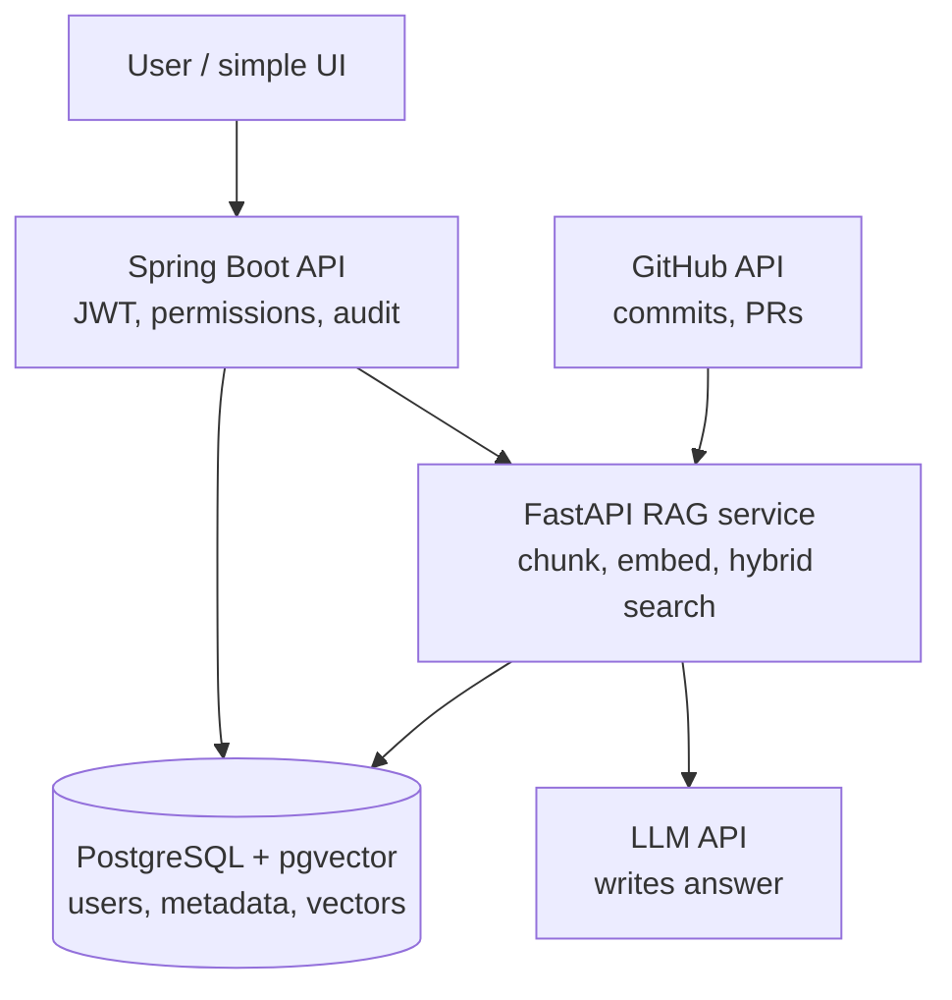

# Employee Knowledge RAG

Permission-aware enterprise knowledge search: two application services over one
PostgreSQL + pgvector datastore.

Built as a 6-phase learning + implementation journey. This repository is
currently at **Phase 2** — ingestion pipeline and GitHub knowledge connector.

## Status: Phase 2

| Area | State |
|---|---|
| `backend-java` (Spring Boot, Java 21) | REST base API (`/search`, `/ask`, `/sync/status`), deterministic auth stub (`employee_42`), audit logging, RAG client |
| `rag-python` (FastAPI, Python 3.12+) | Health/readiness, contract stubs, connector interface, canonical normalization, chunking, embeddings, pgvector indexing, CLI |
| PostgreSQL + pgvector | Canonical schema (`V001__canonical_schema.sql`): users, groups, source_records, documents, chunks, acl_references, sync_state, audit_events, entities, relationships |
| Connectors | GitHub (fixture adapter + API adapter), ticket reference extraction (`DC-8692`) |
| Embeddings | Provider abstraction (`MockEmbeddingProvider` unit-normalized 1536-dim vectors, factory for future OpenAI integration) |
| Incremental Sync | Checkpoint tracking, cursor advancement, retryable failure state |
| Retrieval & LLM synthesis | **Not built** — arrives in Phases 3 & 4 |

Nothing in this repository can return a fabricated answer yet: there is no
retrieval code, no LLM call, and no prompt-based access control.

## Architecture

Two deployable services, one datastore. Full rationale in
[`docs/decisions/ADR-0001-two-service-split.md`](docs/decisions/ADR-0001-two-service-split.md).



Read it like this:

- **U → J** — the employee asks a question. Spring Boot authenticates them and
  decides what they are allowed to see.
- **J → P** — Java passes the *employee's identity and permissions* to the RAG
  service. Java owns permissions; Python does not decide them.
- **G → P** — offline, a connector pulls commits and pull requests from GitHub.
- **P → D** — the RAG service writes chunks, metadata and vectors to Postgres.
  pgvector stores the vectors; PostgreSQL full-text search does keyword search.
- **J → D** — Java reads users, groups and ACL references directly. This is why
  permissions can be enforced *before* anything reaches the LLM.
- **P → L** — only permission-filtered evidence is sent to the LLM, so it can
  never quote a document the employee is not allowed to read.

### The components

- **`backend-java`** — authentication and user context, permission decisions,
  REST APIs, orchestration, audit/admin endpoints. Calls Python.
- **`rag-python`** — connectors, normalisation, chunking, embeddings, retrieval,
  reranking, relationships, LLM, evaluation.
- **PostgreSQL + pgvector** — users, sources, documents, chunks, ACL references,
  sync state, audit, relationships. Full-text search for lexical retrieval,
  pgvector for embeddings.

Redis and Neo4j are deliberately absent. See ADR-0001 for why.

## Quick start

Prerequisites: JDK 21+, Python 3.12+, Docker Desktop.

```bash
# 0. check the toolchain
powershell -ExecutionPolicy Bypass -File scripts/preflight-check.ps1

# 1. local config
cp .env.example .env

# 2. PostgreSQL + pgvector
make up
make pg-ext-check          # expect: vector | 0.8.7

# 3. rag-python  (terminal 1)
cd rag-python
python -m venv .venv
.venv/Scripts/python.exe -m pip install -e ".[dev]"
.venv/Scripts/python.exe -m uvicorn app.main:app --host 127.0.0.1 --port 8000

# 4. backend-java  (terminal 2)
cd backend-java
./mvnw spring-boot:run    # Windows: mvnw.cmd spring-boot:run
```

Verify endpoints:

```bash
# Health checks
curl http://127.0.0.1:8000/health           # {"status":"ok","service":"rag-python"}
curl http://localhost:8080/actuator/health   # {"status":"UP"}

# REST Base API (Phase 1)
curl -X POST http://localhost:8080/api/v1/search -H "Content-Type: application/json" -d "{\"query\": \"validation\"}"
curl -X POST http://localhost:8080/api/v1/ask -H "Content-Type: application/json" -d "{\"question\": \"why did validation change?\"}"
curl http://localhost:8080/api/v1/sync/status
```

## Tests

```bash
make test           # both suites (37 total tests)
make test-backend   # 18 JUnit tests
make test-rag       # 19 pytest tests
```

Neither suite requires PostgreSQL, Docker, or the other service. All tests run
offline and self-contained with mock/in-memory adapters.

## Ingestion Pipeline

To run the GitHub synthetic fixture ingestion into memory or PostgreSQL:

```bash
# Ingest synthetic fixtures into in-memory storage (no Docker needed)
make ingest-fixtures

# Or run the CLI directly with live PostgreSQL (when docker compose is up)
cd rag-python && .venv/Scripts/python.exe -m app.cli.ingest --source github --fixture
```

## Layout

```text
backend-java/          Spring Boot API gateway and orchestrator
  src/main/java/com/company/knowledge/
    auth/              UserContext, DeterministicUserProvider
    audit/             AuditEvent, LoggingAuditService
    search/            SearchController, SearchService, DTOs
    sync/              SyncController, SyncService, DTOs
    common/            ApiError, GlobalExceptionHandler
    orchestrator/
      ragclient/       Java → Python contract boundary (health, search)
rag-python/            FastAPI RAG and ingestion service
  app/
    api/               HTTP routes (health, internal_rag)
    contracts/         wire schemas shared with Java (health, search)
    common/            settings, logging
  tests/
infra/
  docker/init/         Postgres init (001-enable-pgvector, 002-canonical-schema)
  migrations/          Versioned Flyway migrations (V001__canonical_schema.sql)
data/fixtures/         Phase 2+: github, slack, email fixtures
docs/
  api/                 API contract specs (public REST API, Java-Python contract)
  architecture/        system flows, current vs planned
  decisions/           ADRs
  runbooks/            local run and troubleshooting
scripts/               preflight check
```

## Documentation

| Document | Purpose |
|---|---|
| [`DESIGN.md`](DESIGN.md) | Why the system is shaped this way — scope, flows, permission model, data model |
| [`docs/architecture/overview.md`](docs/architecture/overview.md) | Both system flows, marked with what exists today |
| [`docs/api/public-rest-api.md`](docs/api/public-rest-api.md) | Public REST endpoints (`/search`, `/ask`, `/sync/status`) |
| [`docs/api/java-python-contract.md`](docs/api/java-python-contract.md) | Contract endpoints, payloads, error shape, failure handling |
| [`docs/decisions/ADR-0001-two-service-split.md`](docs/decisions/ADR-0001-two-service-split.md) | Why two services, why Postgres, what is deferred |
| [`docs/runbooks/phase-0-local-run.md`](docs/runbooks/phase-0-local-run.md) | Local run, verification, troubleshooting |

## Phase order

```text
Phase 1  canonical schema, user context, API stubs  [COMPLETED]
Phase 2  canonical ingestion + GitHub               [COMPLETED]
Phase 3  hybrid retrieval + Slack
Phase 4  permission enforcement + relationships + RAG
Phase 5  email adapter + incremental sync + admin/audit
Phase 6  evaluation + observability + demo
```
