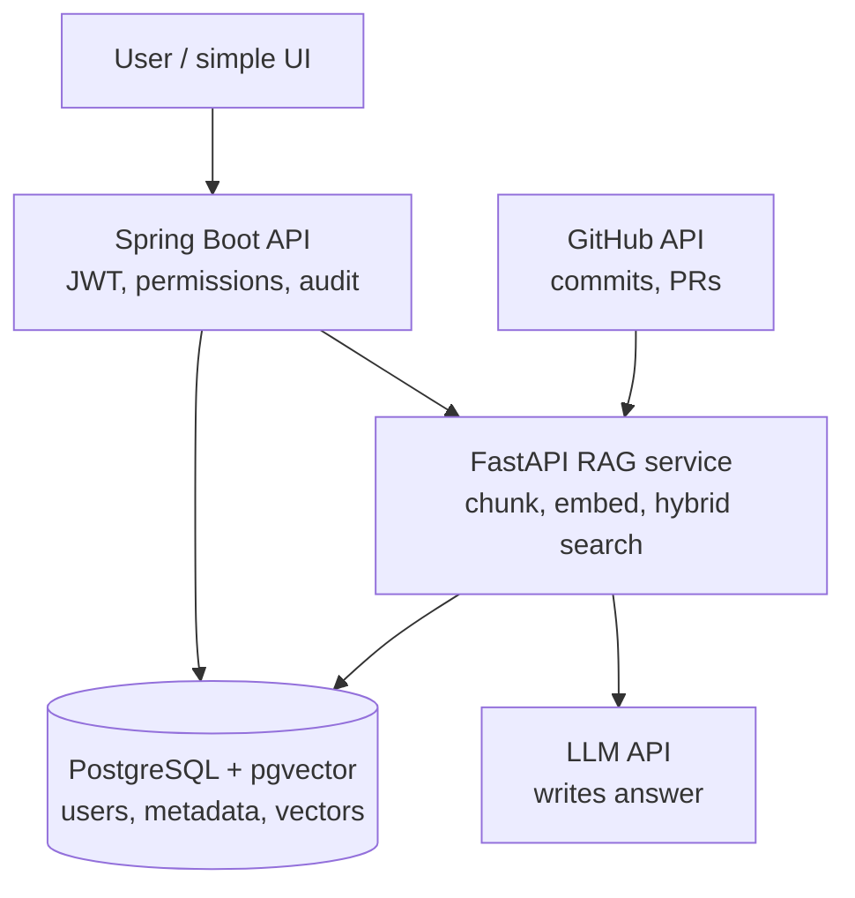

# Employee Knowledge RAG

Permission-aware enterprise knowledge search: two application services over one
PostgreSQL + pgvector datastore.

Built as a 6-phase learning + implementation journey. This repository is
currently at **Phase 0** — foundations only.

## Status: Phase 0

| Area | State |
|---|---|
| `backend-java` (Spring Boot, Java 21) | Skeleton, health endpoint, RAG service client |
| `rag-python` (FastAPI, Python 3.12+) | Skeleton, health/readiness, contract stub |
| PostgreSQL + pgvector via Docker Compose | Running locally, `vector` 0.8.7 |
| Java → Python contract | Documented, tested on both sides |
| Connectors, retrieval, LLM, auth | **Not built** — later phases |

Nothing in this repository can return a fabricated answer yet: there is no
retrieval code, no LLM call and no authentication.

## Architecture

Two deployable services, one datastore. Full rationale in
[`docs/decisions/ADR-0001-two-service-split.md`](docs/decisions/ADR-0001-two-service-split.md).

> **This is the target architecture, not what runs today.**
> Right now only the two service boxes and PostgreSQL exist. `JWT`, `GitHub API`
> and `LLM API` are **not built** — they arrive in Phases 2–4. See
> [Status](#status-phase-0) for what actually exists.



Read it like this:

- **U → J** — the employee asks a question. Spring Boot authenticates them and
  decides what they are allowed to see.
- **J → P** — Java passes the *employee's identity and permissions* to the RAG
  service. Java owns permissions; Python does not decide them.
- **G → P** — offline, a connector pulls commits and pull requests from GitHub.
- **P → D** — the RAG service writes chunks, metadata and vectors to Postgres.
  pgvector stores the vectors; PostgreSQL full-text search does keyword search.
- **J → D** — Java reads users, groups and ACL references directly. This is why
  permissions can be enforced *before* anything reaches the LLM.
- **P → L** — only permission-filtered evidence is sent to the LLM, so it can
  never quote a document the employee is not allowed to read.

### The components

- **`backend-java`** — authentication and user context, permission decisions,
  REST APIs, orchestration, audit/admin endpoints. Calls Python.
- **`rag-python`** — connectors, normalisation, chunking, embeddings, retrieval,
  reranking, relationships, LLM, evaluation.
- **PostgreSQL + pgvector** — users, sources, documents, chunks, ACL references,
  sync state, audit, relationships. Full-text search for lexical retrieval,
  pgvector for embeddings.

Redis and Neo4j are deliberately absent. See ADR-0001 for why.

## Quick start

Prerequisites: JDK 21+, Python 3.12+, Docker Desktop.

```bash
# 0. check the toolchain
powershell -ExecutionPolicy Bypass -File scripts/preflight-check.ps1

# 1. local config
cp .env.example .env

# 2. PostgreSQL + pgvector
make up
make pg-ext-check          # expect: vector | 0.8.7

# 3. rag-python  (terminal 1)
cd rag-python
python -m venv .venv
.venv/Scripts/python.exe -m pip install -e ".[dev]"
.venv/Scripts/python.exe -m uvicorn app.main:app --host 127.0.0.1 --port 8000

# 4. backend-java  (terminal 2)
cd backend-java
./mvnw spring-boot:run    # Windows: mvnw.cmd spring-boot:run
```

Verify:

```bash
curl http://127.0.0.1:8000/health           # {"status":"ok","service":"rag-python"}
curl http://127.0.0.1:8000/ready            # {"status":"ok","service":"rag-python"}
curl http://localhost:8080/actuator/health   # {"status":"UP"}
```

Full walkthrough, including troubleshooting:
[`docs/runbooks/phase-0-local-run.md`](docs/runbooks/phase-0-local-run.md)

## Tests

```bash
make test           # both suites
make test-backend   # 5 JUnit tests
make test-rag       # 5 pytest tests
```

Neither suite requires PostgreSQL, Docker, or the other service. A contract test
that needs both processes running is a contract test that gets skipped.

## Layout

```text
backend-java/          Spring Boot API gateway and orchestrator
  src/main/java/com/company/knowledge/
    common/            ApiError, exception handling
    orchestrator/
      ragclient/       Java → Python contract boundary
rag-python/            FastAPI RAG and ingestion service
  app/
    api/               HTTP routes
    contracts/         wire schemas shared with Java
    common/            settings, logging
  tests/
infra/
  docker/init/         first-boot Postgres init (enables pgvector)
  migrations/          Phase 1: versioned schema migrations
data/fixtures/         Phase 2+: github, slack, email fixtures
docs/
  api/                 Java → Python contract specification
  architecture/        system flows, current vs planned
  decisions/           ADRs
  runbooks/            local run and troubleshooting
scripts/               preflight check
```

## Documentation

| Document | Purpose |
|---|---|
| [`DESIGN.md`](DESIGN.md) | Why the system is shaped this way — scope, flows, permission model, data model |
| [`docs/architecture/overview.md`](docs/architecture/overview.md) | Both system flows, marked with what exists today |
| [`docs/api/java-python-contract.md`](docs/api/java-python-contract.md) | Contract endpoints, payloads, error shape, failure handling |
| [`docs/decisions/ADR-0001-two-service-split.md`](docs/decisions/ADR-0001-two-service-split.md) | Why two services, why Postgres, what is deferred |
| [`docs/runbooks/phase-0-local-run.md`](docs/runbooks/phase-0-local-run.md) | Local run, verification, troubleshooting |

## Security status

- No secrets are committed. `.env` is git-ignored; `.env.example` holds
  placeholders only.
- **The internal Java → Python contract is unauthenticated.** Acceptable in
  Phase 0 because only a static health string crosses it. A shared token or mTLS
  is a hard prerequisite before any real data flows.
- No employee authentication or authorization exists yet.

## Known deviation from the brief

The journey README suggests Java 25. This project targets **Java 21 LTS +
Spring Boot 3.5.x**. Reasoning in ADR-0001 under "Deviations from the original
brief".

## Phase order

```text
Phase 1  canonical schema, user context, API stubs
Phase 2  canonical ingestion + GitHub
Phase 3  hybrid retrieval + Slack
Phase 4  permission enforcement + relationships + RAG
Phase 5  email adapter + incremental sync + admin/audit
Phase 6  evaluation + observability + demo
```

Permission enforcement arrives in Phase 4, but an ACL reference is stored on
every searchable unit from Phase 1 onward — retrofitting permissions after
indexing real data is the expensive mistake this ordering avoids.