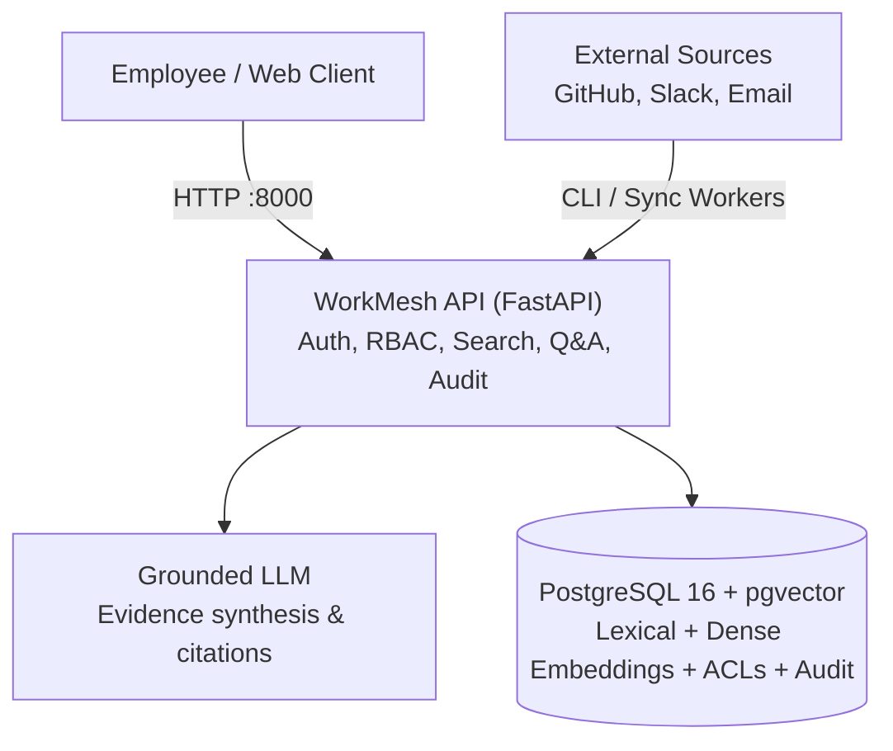

# WorkMesh

Permission-aware enterprise knowledge search and question answering with verifiable citations.
Powered by a single FastAPI service on PostgreSQL 16 with pgvector.

---

## What WorkMesh Does

- **Hybrid Search**: Combines PostgreSQL full-text search (`tsvector`) with dense vector search (`all-MiniLM-L6-v2` via `pgvector`) using Reciprocal Rank Fusion (RRF).
- **Graph Reranking**: Boosts relevant results based on entity relationships across GitHub pull requests, Slack messages, and internal emails.
- **Pushdown Access Control**: Enforces document-level permissions inside PostgreSQL queries so users never see content outside their authorized groups.
- **Grounded Answers**: Extracts supporting citations `[1]` linked to original sources. Declines to answer when evidence is missing or unauthorized.
- **Audit Logging & Admin**: Tracks search and question queries durably with fail-open resilience, plus role-protected connector sync status endpoints.

---

## Evaluation Benchmark & Real Ablation Study

Evaluated over 10,000 multi-tenant chunks (2,500 documents across GitHub, Slack, and Email) with 12,500 ACL rules over 50 simulated users and 5 departments in PostgreSQL + pgvector (`python -m app.cli.scale_benchmark --skip-seed --ablation`).

### 1. Scale & Security Benchmark

| Metric | Measured Result | Target | Status |
|---|---|---|---|
| **Recall@1** | **64.0%** | >= 50.0% | PASS |
| **Recall@5** | **72.0%** | >= 55.0% | PASS |
| **Recall@10** | **76.0%** | >= 60.0% | PASS |
| **Mean Reciprocal Rank (MRR)** | **0.6748** | >= 0.5000 | PASS |
| **Cross-Tenant Permission Leak Rate** | **0.0%** (0 leaks / 500 adversarial queries) | 0.0% | PASS |
| **Adversarial Security Throughput** | **147.2 ms / query** (500 queries in 73.6s) | < 200 ms | PASS |

Raw results: [`data/evaluation/results/scale_benchmark_results.json`](data/evaluation/results/scale_benchmark_results.json).

### 2. Retrieval Ablation Study

Ablation evaluation across 100 queries (50 exact identifier tickets vs. 50 semantic queries) isolating the impact of each retrieval stage:

| Retrieval Strategy | Exact-ID Queries (50) | Semantic Queries (50) | Overall Recall@5 | Overall MRR |
| :--- | :---: | :---: | :---: | :---: |
| **Lexical Only (`tsvector` / GIN)** | 100.0% | 20.0% | **60.0%** | 0.6000 |
| **Vector Only (`pgvector` cosine)** | 42.0% | 34.0% | **38.0%** | 0.3062 |
| **Hybrid RRF ($k=60$)** *(Baseline)* | 100.0% | 44.0% | **72.0%** | **0.6748** |
| **Hybrid + Graph Context Reranking** | 100.0% | 50.0% | **75.0%** | **0.6837** |

*Note: With an exact 50/50 query split, Overall Recall@5 is the exact arithmetic mean of Exact-ID and Semantic categories (e.g. \((100\% + 44\%) / 2 = 72.0\%\) for baseline RRF, and \((100\% + 50\%) / 2 = 75.0\%\) with graph reranking).*

Raw results: [`data/evaluation/results/ablation_results.json`](data/evaluation/results/ablation_results.json).

---

## Architecture

A single consolidated FastAPI application interfacing directly with PostgreSQL 16 + pgvector. See [`docs/decisions/ADR-0001-two-service-split.md`](docs/decisions/ADR-0001-two-service-split.md).



---

## Quick Start

### 1. Run with Docker Compose

```bash
# Start PostgreSQL and the WorkMesh API
docker compose -f docker-compose.demo.yml up --build -d

# Verify readiness (checks live database connection)
curl http://localhost:8000/ready

# Search enterprise knowledge
curl -s -X POST http://localhost:8000/api/v1/search \
  -H "Content-Type: application/json" \
  -H "X-User-Id: employee_42" \
  -d '{"query": "DC-8692"}'

# Ask a grounded question
curl -s -X POST http://localhost:8000/api/v1/ask \
  -H "Content-Type: application/json" \
  -H "X-User-Id: employee_42" \
  -d '{"question": "Why did we change the validation flow?"}'
```

### 2. Interactive Web UI

- **Live UI**: Open [`http://localhost:8000/`](http://localhost:8000/) in your browser while the service is running.
- **Offline UI**: Open [`demo-ui/index.html`](demo-ui/index.html) directly in any browser with the offline simulation toggle.

### 3. Local Development

```bash
# Start database
docker compose up -d postgres

# Install Python dependencies and start API
cd rag-python
python -m venv .venv
.venv/Scripts/python.exe -m pip install -e ".[dev]"
.venv/Scripts/python.exe -m uvicorn app.main:app --host 127.0.0.1 --port 8000

# Ingest synthetic documents
.venv/Scripts/python.exe -m app.cli.ingest --source all

# Run 10,000-chunk scale benchmark & ablation study
.venv/Scripts/python.exe -m app.cli.scale_benchmark --skip-seed --ablation
```

---

## Tests

The test suite runs self-contained and offline:

```bash
cd rag-python
.venv/Scripts/pytest.exe tests
```

278 passed tests covering hybrid retrieval, pushdown ACL enforcement, grounded answer synthesis, citation validation, role-based access control, and error handling contracts.

---

## Documentation

- [`DESIGN.md`](DESIGN.md): System architecture, data model, and pushdown ACL invariant.
- [`docs/runbooks/final-demo-script.md`](docs/runbooks/final-demo-script.md): Live walkthrough script with example queries.
- [`docs/runbooks/evaluation-and-metrics.md`](docs/runbooks/evaluation-and-metrics.md): Evaluation methodology and metrics definitions.
- [`docs/decisions/ADR-0001-two-service-split.md`](docs/decisions/ADR-0001-two-service-split.md): Consolidation rationale to single FastAPI service.
- [`docs/decisions/ADR-0002-redis-deferral.md`](docs/decisions/ADR-0002-redis-deferral.md): Datastore simplicity and Redis deferral rationale.
